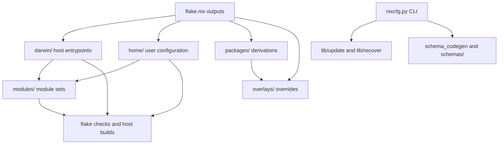

# Agent Guide for `nixcfg`

This file is the agent-facing rule book for this repository.

`CLAUDE.md` is a symlink to this file. Edit `AGENTS.md`, not `CLAUDE.md`, and
keep the symlink intact.

## Repository Map

The repository is a mixed Nix and Python codebase. The diagram shows the main
surfaces and their relationships.

## Documentation Tree

The documentation tree holds the long-form guides. Read the applicable guide
before you change a subsystem.

- [Repository README](README.md)
- [Documentation index](docs/README.md)
- [Architecture](docs/architecture.md)
- [Framework](docs/framework.md)
- [Development](docs/development.md)
- [Interactive toolchains](docs/interactive-toolchains.md)
- [Packaging](docs/packaging.md)
- [Source modifications](docs/source-modifications.md)
- [Appearance](docs/appearance.md)
- [Update pipeline](docs/update/README.md)
- [CI operation](docs/update/ci.md)
- [Update runtime and durability](docs/update/runtime.md)
- [Update safety](docs/update/safety.md)
- [Update free-tier ceiling](docs/update/free-tier-ceiling.md)
- [Schema codegen](schemas/codegen/README.md)
- [Codegen lockfile spec](schemas/codegen/LOCKFILE_SPEC.md)

## Start Here Every Time

Before you change code, do the smallest possible orientation pass:

1. Check the worktree:
   - `git status --short`
   - `git diff --stat`
   - `git diff --cached` if anything is staged
1. Identify the subsystem from the symptom.
1. If the task is part of ongoing work, inspect each continuity source:
   - `.dex/tasks.jsonl`
   - `git stash list`
   - recent Pi sessions under the repo-specific directory in `~/.pi/agent/sessions/`
   - recent Claude sessions under the repo-specific directory in `~/.claude/projects/`
   - recent OpenCode sessions in `~/.local/share/opencode/opencode.db` filtered to this worktree
   - recent Codex sessions under `~/.codex/sessions/` that mention this worktree
1. Prefer a narrow reproduction before a full build or full-closure apply.
1. Before handoff, review your own diff for regressions, generated-file drift,
   CI/update fallout, and platform-specific breakage.

Local history for this repo heavily favors root-cause analysis, workflow
failure investigation, and explicit self-review passes. Match that style. The
full list of continuity sources is in
[Continuity Sources](#continuity-sources).

## Non-Negotiable Guardrails

These are hard rules, not suggestions.

- Do not use `--no-verify` with `git commit`, `git push`, or related git flows
  in this repo.
- If hooks fail, fix the underlying issue or stop and ask the user. Do not
  bypass the hook as a shortcut.
- If partial staging or commit-splitting makes hooks awkward, use a safer flow
  instead. Use temporary patches, an isolated worktree, or a clean commit split
  that still allows hooks to run normally.
- Before push, do not rely on spot checks when repo hooks or CI define stricter
  gates. Run `prek run -a` or the exact relevant CI-parity commands on the
  final tree.
- Do not push changes while any known required local quality gate is failing.

The [Validation Ladder](#validation-ladder) lists the local gates in full.

## What This Repository Actually Is

This repository is not just a personal dotfiles repo. It is a mixed Nix and
Python codebase with several public and semi-public surfaces:

- a personal `nix-darwin` + Home Manager flake
- reusable exported `darwin`, `home`, and `nixos` module sets
- a Python `nixcfg` CLI in `nixcfg.py` with substantial logic under `lib/`
- update/CI tooling under `lib/update/` and `lib/recover/`
- a schema/codegen toolchain under `schema_codegen.yaml`, `schemas/`, and
  `lib/schema_codegen/`
- custom packages and overlays under `packages/` and `overlays/`

Important entrypoints:

- `flake.nix`
- `default.nix`
- `lib.nix`
- `lib/exports.nix`
- `darwin/argus.nix`
- `darwin/rocinante.nix`
- `darwin/zeus.nix`
- `home/george/default.nix`
- `nixcfg.py`

The host entrypoints are intentionally thin. Shared behavior usually belongs
in `modules/`, `lib/lib.nix`, `default.nix`, or `lib/exports.nix`. A host file
holds shared behavior only when the change is truly machine-specific.

See [Architecture](docs/architecture.md) and [Framework](docs/framework.md).

## Where To Look First

Use the symptom to select the subsystem.

### Host And User Configuration

- `darwin/` — host entrypoints
- `home/` — user config, scripts, app configs
- `modules/darwin/`, `modules/home/`, `modules/nixos/` — reusable module logic

### Packages, Overlays, And Build Failures

- `packages/`
- `overlays/`
- `packages/registry.nix`
- `packages/default.nix`
- `overlays/default.nix`
- `packages/*/sources.json`
- `packages/*/updater.py`
- `packages/*/Cargo.nix`
- `packages/*/crate-hashes.json`
- `packages/*/uv.lock`
- `overlays/*/sources.json`

See [Packaging](docs/packaging.md) and
[Source modifications](docs/source-modifications.md).

### Update And CI Failures

- `lib/update/`
- `lib/recover/`
- `lib/update/ci/`
- `nix run .#nixcfg -- ci --help`
- `nix run .#nixcfg -- update --help`

See the [update pipeline](docs/update/README.md),
[CI operation](docs/update/ci.md),
[update runtime and durability](docs/update/runtime.md), and
[update safety](docs/update/safety.md).

### Public API And Exported Framework Behavior

- `default.nix`
- `lib.nix`
- `lib/lib.nix`
- `lib/exports.nix`
- `tests/nix/default-api/default-api.nix`
- `lib/tests/test_update_nix_ast.py`

See [Framework](docs/framework.md). The schema and codegen toolchain has its
own guides: [Schema codegen](schemas/codegen/README.md) and
[Codegen lockfile spec](schemas/codegen/LOCKFILE_SPEC.md).

### OpenCode, MCP, And Profile Wiring

- `modules/home/opencode.nix`
- `home/george/mcp-catalog.nix`
- `home/george/work.nix`
- `darwin/argus.nix`
- `darwin/rocinante.nix`
- `darwin/zeus.nix`

See [Development](docs/development.md).

### Zen And Twilight Browser Work

- `modules/home/zen.nix`
- `modules/home/zen/zentool`
- `home/george/zen/`

See [Appearance](docs/appearance.md).

## Dominant Workstreams From Repo History

Five themes dominate recent Pi and OpenCode history for this worktree:

1. **Periodic Flake Update and CI failures**
1. **Argus system closure regressions**
1. **Package / overlay / crate2nix / hash drift breakage**
1. **OpenCode / MCP / profile configuration**
1. **Audit, simplification, and self-review before handoff**

That history suggests the right default behavior:

- start from the failing artifact, job, derivation, or package
- assume the visible failure may be downstream of a different root cause
- review staged or final diffs explicitly before you finish
- avoid broad rewrites when a targeted fix is available

Failures often surface through `argus`. The real bug lives in `packages/`,
`overlays/`, or `lib/update/`.

## Repo Patterns You Must Preserve

### 1. `flake.nix` Pins Are Often Intentional Operational Workarounds

`flake.nix` contains comments and pins for active upstream breakage or behavior
differences. Examples include temporary forks, pinned revisions, and disabled
integrations. Do not casually “clean up” those pins. First find out why they
were introduced.

Homebrew tap inputs are part of this rule. For example, `homebrew-cask` may be
pinned because upstream cask syntax can get ahead of the Homebrew/Ruby runtime
available through this flake. One case is a bare `depends_on :macos` that
requires newer Homebrew behavior. If Homebrew activation fails, inspect
`flake.nix`, `modules/darwin/homebrew.nix`, and the relevant tap pin before you
unpin or update the tap.

### 2. Package Discovery Is Structured, Not Ad Hoc

- `packages/default.nix` and `packages/registry.nix` are part of the packaging
  architecture.
- Packages are auto-discovered.
- System constraints live in `packages/registry.nix`.
- The repo discovers and exports companion `crate2nix-src.nix` entries too.

If you add or rename a package, check discovery and system constraints, not
just the derivation itself.

### 3. Overlays Are Fragment-Based

`overlays/default.nix` auto-imports overlay fragments and combines them with
helper overlays. Use `overlays/` when you need `final` / `prev` semantics or
when you override nixpkgs behavior. Use `packages/` for standalone
`callPackage` derivations.

### 4. Source-Backed Packages Use Shared `selfSource` Plumbing

The repo now centralizes sibling `sources.json` injection through:

- `lib/package-self-source.nix`
- `default.nix`
- `packages/default.nix`

If a package expects `selfSource`, make sure the sibling `sources.json` pattern
still works through the shared helper. Do not invent a one-off path.

### 5. Darwin App Packaging Has A Shared Pattern

For macOS GUI apps, prefer the shared pattern built around:

- `overlays/_lib/helpers/darwin-apps.nix`
- `lib/mac-apps.nix`
- `passthru.macApp`
- `nixcfg.macApps.applications.<name>` with `scope = "system"`

Do not add bespoke activation hacks for `/Applications` unless the shared
pattern genuinely cannot express the need.

### 6. `default.nix` / `lib.nix` / `lib/exports.nix` Are API Surfaces

The repo exports constructors and module sets for downstream use. If you touch
these files, treat them as public API and validate accordingly. Preserve
constructor names and module export intent unless the task explicitly changes
API shape.

### 7. Prefer AST-Backed Nix Generation From Python

When Python needs to construct or compose Nix code, prefer `nix-manipulator`
AST builders over raw Nix string templates. For Nix-native behavioral checks,
prefer dedicated `.nix` test files or flake checks. Do not embed multiline Nix
programs in Python. Only use inline Nix strings in Python when they are
clearly simpler and better for the task at hand.

## Python Test Philosophy

Apply this guidance to all maintained Python surfaces in this repo. The
surfaces are `nixcfg.py`, `lib/**/*.py`, `packages/**/*.py`,
`overlays/**/*.py`, `modules/**/*.py`, and extensionless Python entrypoints.

Treat Python tests as the executable spec for maintained Python behavior. Aim
for complete branch coverage of maintained Python logic, including success
paths, failure paths, and edge cases. Treat uncovered branches as missing
tests or as a design smell. Simplify or refactor a design smell.

Use this testing order by default:

1. pure Python unit tests
1. Nix AST assertions with `nix-manipulator`
1. mocked Python-side subprocess or wrapper tests
1. real Nix evaluation only when the semantic property cannot be established
   above

When Python produces, rewrites, or composes Nix, test the result structurally.
Prefer `nix-manipulator` builders and AST assertions through the shared test
helpers. Prefer AST equality over string equality unless exact rendered text is
itself the contract.

Do not assert that source files contain or omit raw string fragments. If a
test needs to protect source behavior, parse the source and assert on the
semantic structure:

- Nix ASTs for Nix, Python AST or CST for Python
- JSON/TOML/YAML parsers for data files
- shell/JS syntax or runtime harnesses for embedded scripts

Keep substring assertions for presentation output only when the text itself is
the user-facing contract.

Do not use Nix evaluation merely to prove that Python emitted the right Nix. If
production code currently returns Nix text, parse it in the test and compare
ASTs. If that is awkward, prefer a refactor of the production code toward
explicit Nix AST builders.

Treat real Nix evaluation as an exception. Use it only when the semantic
property cannot be established at the AST level. Keep those evals extremely
lightweight:

- import only the smallest unit under test
- use tiny `--expr` harnesses
- return JSON or raw scalars
- never trigger builds, flake checks, host evaluations, closures, or broad
  module graphs from pytest

When Python code shells out to Nix or subprocess helpers, test Python behavior
at the Python boundary first. Mock `run_nix`, `run_nix_json`, `subprocess.run`,
or equivalent wrappers to cover control flow, argument construction, parsing,
timeouts, and failures. Reserve real Nix invocation for narrow semantic checks
that cannot be replaced with AST or mocked-boundary tests.

Any new eval-based test must include a short docstring or comment that explains
why AST-only or pure-Python testing was insufficient.

If existing code or tests do not fit this philosophy, refactor them when you
encounter them. Prefer separating pure Python decision logic, Nix AST
construction/rendering, and thin subprocess/evaluation adapters. Do not
preserve heavyweight, stringly, or broad-eval tests just for consistency with
older patterns. Move them toward pure Python and AST-based assertions when
touched.

## Investigation Rules

### Prefer Targeted Root-Cause Analysis

Start from one of these before you do anything expensive:

- the failing derivation log
- the specific package or overlay
- the generated artifact that drifted
- the exact staged diff that introduced the change

### Do Not Accept “Build From Source” As A Substitute When Caches Should Exist

If the user expects cached or prebuilt outputs, investigate why a cached path,
version, or hash diverged. Do not assume a from-source rebuild is an acceptable
outcome.

### Preserve Platform Guards

This flake exports:

- `aarch64-darwin`
- `aarch64-linux`
- `x86_64-linux`

Do not remove or weaken platform guards casually. Platform-specific drift
causes many recurring failures in this repo.

### Treat Hash And Generated Artifact Drift As First-Class Issues

Common failure classes here:

- `sources.json` drift
- `uv.lock` drift
- `Cargo.nix` / `crate-hashes.json` drift
- `packages/superset/bun.nix` drift
- `npmDepsHash` / `denoDepsHash` / `vendorHash` mismatches

### During Simplification, Remove Accidental Complexity. Do Not Break Discovery Or Exports

Recent history includes several simplification passes. Good simplifications
here usually:

- deduplicate helper plumbing
- reduce repeated let-bindings in thin derivations
- move common package/update logic into shared helpers

Bad simplifications usually:

- hide platform distinctions
- bypass package/overlay discovery
- break exported constructors or module names
- inline generated values that should stay machine-maintained

## Task-Specific Guidance

### Darwin Host Build Failures

Start with:

- `nix build .#checks.aarch64-darwin.darwin-argus`
- `nix build .#checks.aarch64-darwin.darwin-rocinante`
- `nix build .#checks.aarch64-darwin.darwin-zeus`

If the failure mentions a package, switch quickly into that package or overlay.
Do not look only at the host module.

### Add Or Update A Package

Check these first:

- `packages/registry.nix`
- similar existing packages in `packages/` or `overlays/`
- `packages/default.nix`
- `lib/package-self-source.nix` for sibling `sources.json` / `selfSource`
  plumbing

For source-backed packages, make sure the full pattern is coherent:

- derivation file
- `sources.json` if needed
- `updater.py` if needed
- system constraint in `packages/registry.nix` if not universal
- validation build for the real target platform

### Update CI Or Update Logic

The update pipeline is phase-structured: flake reference refresh, source
discovery and hashing, generated-artifact materialization, derivation
validation, then atomic promotion. Make changes phase-consciously.
Platform-specific updater guards and crate2nix refreshes run locally through
the CLI. The GitHub Actions Update workflow uses disposable native builders.
See [CI operation](docs/update/ci.md). Keep execution and promotion semantics
in the CLI.

The bounded Update repair agent (`lib/update/repair.py`) may disable
`checkPhase` only when all of the following are true:

1. the failure is an upstream package's own tests (not compile/link)
1. the derivation built before checks
1. the failure is not in George's overlay/app/home-manager module code
1. the skip is `doCheck = false` (or equivalent) pinned to the failing version
   with a comment that cites the test and signal
1. the skip is documented in the change

Never skip SIGBUS, runner-lost-communication, store `ValidationIncomplete`,
compile/link failures, George's own overlay/app/module code, or Darwin
validation itself. See [Update safety](docs/update/safety.md) and
[Update runtime and durability](docs/update/runtime.md).

### OpenCode, MCP, And Profile Setup

Keep the reusable OpenCode mechanism in `modules/home/opencode.nix`, George's
MCP inventory in `home/george/mcp-catalog.nix`, and host-specific work policy
in `home/george/work.nix`. Do not move personal MCP servers or work packages
back into the exported module set.

### Zen And Twilight Browser Work

Use the dedicated module and repo-managed Zen tooling:

- `modules/home/zen.nix`
- `modules/home/zen/zentool`
- `home/george/zen/folders.yaml`

Remember that Zen folder reconciliation is stateful and interacts with a live
browser profile. See [Appearance](docs/appearance.md).

#### Catppuccin chrome theme wiring — do not touch unless explicitly asked

The Zen chrome theme (`userChrome.css`, `userContent.css`,
`zen-logo-<variant>.svg`) is **not** maintained in this repo. It comes from the
`catppuccin-zen-browser` flake input. That input pins the `gkze/zen-browser`
fork on branch `fix/frappe-zen-twilight-acrylic-gap`, until the fix lands
upstream in `catppuccin/zen-browser`. See the committed architecture at
`home/george/configuration.nix`. The `zen.chromeSource` is a `pkgs.runCommand`
derivation that symlinks the three files from `themes/${Variant}/${Accent}/` in
the flake input. `config.theme.variant` and `config.theme.accentColor` drive
that selection.

Hard rules for this setup:

- Do **not** re-add `home/george/zen/chrome/` with hand-copied `userChrome.css` /
  `userContent.css` / `zen-logo-*.svg`. Those files belong upstream in the fork.
  If a theme tweak is needed, make it on the `gkze/zen-browser` fork branch and
  bump the flake input.
- Do **not** add a `home.activation.directZenRepoSymlinks` (or similar) script
  that live-links `~/.config/zen/chrome/*` to working-tree paths. The
  declarative `chromeSource` path already materializes the correct store path;
  `zentool` then syncs it into the live profile.
- Do **not** set `nixcfg.zen.chromeSource = null` in
  `home/george/configuration.nix`. `null` disables the Nix-store
  materialization and leaves the profile unthemed.
- `home/george/zen/user.js` is genuinely local (not a copy of upstream) and
  contains the `ui.systemUsesDarkTheme = 1` workaround for
  [zen-browser/desktop#9542](https://github.com/zen-browser/desktop/issues/9542).
  Without that pref, every `@media (prefers-color-scheme: dark)` rule in the
  Catppuccin userChrome.css evaluates false. The whole theme then silently
  fails to apply. Do not remove that pref.

If you think the chrome theme is broken, the first diagnostic is almost always
one of:

1. Uncommitted regression in `flake.nix` / `flake.lock` /
   `home/george/configuration.nix` that reverted the fork-sourcing. Run
   `git diff HEAD -- flake.nix flake.lock home/george/configuration.nix home/george/zen/` first.
1. Missing `ui.systemUsesDarkTheme` pref in `home/george/zen/user.js`.
1. Drift between the fork branch and current Zen internals — fix in the fork,
   not here.

Known Twilight quit-dialog lessons from the 2026-04 upgrade:

- Do not treat a bad quit dialog as proof that `userChrome.css` does not load.
  Prove the chrome CSS load with a temporary, unmistakable wrapper or
  background marker outside `@media (prefers-color-scheme: dark)`. Restart
  Twilight, then remove the marker after the check.
- The quit warning is `chrome://global/content/commonDialog.xhtml`. Its buttons
  are created inside the `<dialog id="commonDialog">` shadow root. Outer
  `userChrome.css` sees every button only as `part="dialog-button"`. Pure
  `dialog::part(dialog-button)` rules can theme the dialog shell and the
  secondary buttons. Those rules cannot reliably target only the accept or
  `Quit` button, or its internal `.button-box` / `.button-text`.
- For accept-button fixes, use the repo-managed AutoConfig path in
  `home/george/zen/autoconfig/`. Keep it as a minimal bridge. Run in the
  common-dialog document. Strip the native `default` attribute from
  `button[dlgtype="accept"]` / `label^="Quit "`. Preserve the existing
  `dialog-button` part. Add the `catppuccin-primary-button` part token, so the
  Catppuccin `userChrome.css` owns the actual colors and the hover and active
  states. In AutoConfig, prefer XPCOM services from `Components.classes[...]`.
  Importing `Services.sys.mjs` can fail in that context.
- The safe package path is loose AutoConfig files plus ad-hoc re-signing.
  Install `autoconfig.js` under both `Contents/Resources/defaults/pref/` and
  `Contents/Resources/browser/defaults/preferences/`. Install `twilight.cfg`
  under both `Contents/Resources/` and `Contents/Resources/browser/`. Then sign
  the final app bundle. Do not patch `browser/omni.ja` with `/usr/bin/zip`.
  That patch made Twilight launch and immediately quit.
- Do not leave exploratory diagnostics in `prefs.js` or the app bundle. If you
  add temporary prefs, visible CSS markers, copied files, or backup bundles
  while debugging, remove them before handoff.

## Validation Ladder

Use the narrowest relevant checks first. Do not jump straight to the most
expensive command unless the task needs it.

### Format Checks And Local Hooks

- `nix fmt`
- `prek run -a`

### Python Quality

- `uv run ruff check --config pyproject.toml .`
- `uv run ty check .`
- `uv run pytest`
- `uv run coverage run -m pytest && uv run coverage report`

Quality bar reminders:

- Python is `3.14+`
- Ruff is configured aggressively
- `ty` warnings fail
- coverage floor is `100%`, with explicit reason-annotated exclusions

Coverage exclusion policy:

- The floor stays at 100%.
- Exclude a line or branch with `# pragma: no cover -- <reason>` or
  `# pragma: no branch -- <reason>`. The reason is mandatory. A bare pragma does
  not exclude anything.
- An exclusion is valid only when a test merely restates the implementation.
  Examples:
  - a defensive re-raise
  - a `__main__` guard
  - an abstract method body
  - a platform branch that CI cannot execute
- If a branch can fail meaningfully, write a behavioral test instead. If it
  cannot execute at all, consider deleting the branch before excluding it.
- A whole-module exemption is not allowed, except through an explicit
  commented entry in `pyproject.toml`.
- Do not satisfy the floor with tests that mock every collaborator just to walk
  a line. That is the design smell the policy exists to prevent.

### Nix, Flake, And Host Outputs

- `nix flake check`
- `nix build .#checks.aarch64-darwin.darwin-argus`
- `nix build .#checks.aarch64-darwin.darwin-rocinante`
- `nix build .#checks.aarch64-darwin.darwin-zeus`
- `nix build .#homeConfigurations.george.activationPackage`
- `nix build .#pkgs.<system>.<name>` for package-focused work

Only use this when the task truly requires an actual local apply:

- `nh darwin switch --no-nom .`

### Update And Artifact Validation

- `uv run python -m lib.update.ci.crate2nix`
- relevant `nix run .#nixcfg -- ci ...` subcommands
- relevant `nix run .#nixcfg -- update ...` commands

### CSS And Web-Y Additions

If the task touches CSS or related frontend-ish repo assets, validate that too:

- `nix build .#checks.x86_64-linux.format-web-oxfmt`
- `nix build .#checks.x86_64-linux.lint-web-oxlint`

## Commit And Review Norms

Recent human-authored commits are overwhelmingly conventional-commit style.
Prefer subjects like:

- `fix(ci): ...`
- `fix(update): ...`
- `fix(packages): ...`
- `feat(packages): ...`
- `refactor(update): ...`
- `chore: ...`

Notes:

- old `nix: Update ...` and `flake.lock: Update ...` commits exist, but they are
  older automation-shaped commits
- commitlint is enforced
- if the user explicitly asks you to commit, use `git commit -S`

Before you finish substantial work, do a review pass against your own diff.
OpenCode history for this repo shows very heavy use of explicit self-review
subagents. Emulate that discipline even when you work alone.

## Generated, Sensitive, And Local-State Files

### Do Not Hand-Edit Unless The Task Is Explicitly About Regeneration

- `.pre-commit-config.yaml`
- `packages/**/Cargo.nix`
- `packages/**/crate-hashes.json`
- `packages/**/sources.json`
- `packages/**/uv.lock`
- `overlays/**/sources.json`
- `packages/superset/bun.nix`
- `lib/**/_generated.py`

### Treat Carefully

- `~/.pi`
- `~/.claude`
- `~/.local/share/opencode`

Use local history for continuity, but do not surface credentials or paste
sensitive local data back into the conversation.

## Continuity Sources

If the user asks “where were we?”, “what is this worktree trying to do?”, or
wants work formalized:

- inspect `git status`, `git diff`, and `git diff --cached`
- inspect `git stash list`
- inspect `.dex/tasks.jsonl`
- inspect recent Pi sessions under the repo-specific directory in `~/.pi/agent/sessions/`
- inspect recent Claude sessions under the repo-specific directory in `~/.claude/projects/`
- inspect recent OpenCode sessions in `~/.local/share/opencode/opencode.db` filtered to this worktree
- inspect recent Codex sessions under `~/.codex/sessions/` that mention this worktree

The local histories are genuinely useful here. This repo has a lot of
long-running, iterative debugging and architecture work.

## Usually Ignore Unless The Task Is About Them

These are commonly local state or generated artifacts, not source-of-truth code:

- `.direnv/`
- `.venv/`
- `node_modules/`
- `result/`
- `.pytest_cache/`
- `.ruff_cache/`
- `.coverage*`
