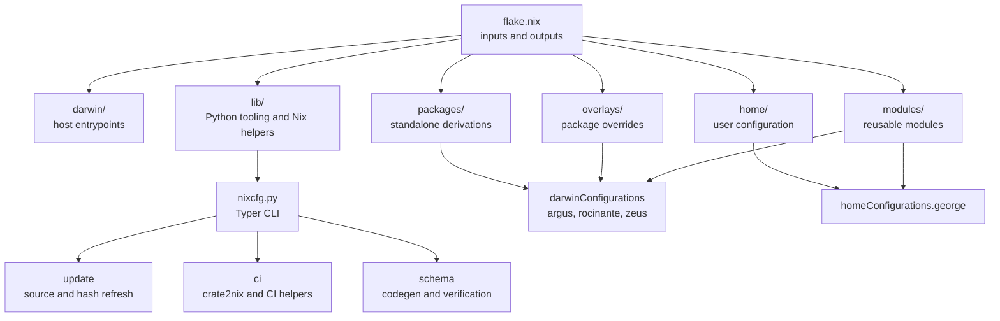

# nixcfg

[![License][c]][d] [![Last commit][e]][f]
[![Commit activity][g]][f] [![Nix flake][h]][i]
[![Platforms][j]][k]

Unified [Nix flake](https://nix.dev/concepts/flakes) for macOS hosts,
[Home Manager](https://github.com/nix-community/home-manager) user
configuration, and reusable module building blocks.

The repository still targets George's machines, user profile, and workflows.
Ongoing work separates those personal defaults into reusable framework
primitives and a standalone module library.

## Repository map



Read [docs/architecture.md](docs/architecture.md) for the full layout and the
output inventory. Read [docs/README.md](docs/README.md) for the documentation
index.

## Current state

- Primary focus is [nix-darwin](https://github.com/nix-darwin/nix-darwin) plus
  [Home Manager](https://github.com/nix-community/home-manager).
- Active Darwin hosts: [`argus`](darwin/argus.nix) and
  [`zeus`](darwin/zeus.nix) (work profile enabled), plus
  [`rocinante`](darwin/rocinante.nix) (personal profile).
- Active Home Manager output: [`homeConfigurations.george`](flake.nix).
- Exported systems: [`aarch64-darwin`](flake.nix),
  [`aarch64-linux`](flake.nix), [`x86_64-linux`](flake.nix).
- NixOS modules are exported, but no
  [`nixosConfigurations`](flake.nix) exist today.

| Host        | System           | Profile  |
| ----------- | ---------------- | -------- |
| `argus`     | `aarch64-darwin` | work     |
| `zeus`      | `aarch64-darwin` | work     |
| `rocinante` | `aarch64-darwin` | personal |

## Install and apply

1. Install vanilla Nix with the official multi-user installer:

   ```bash
   curl -L https://nixos.org/nix/install | sh -s -- --daemon
   ```

   Then open a new terminal, or load the daemon profile in the current shell:

   ```bash
   . /nix/var/nix/profiles/default/etc/profile.d/nix-daemon.sh
   ```

1. Clone this repository to [`~/.config/nixcfg`](.).

1. Bootstrap nix-darwin with an explicit host. The pre-switch macOS hostname is
   not declarative yet:

   ```bash
   cd ~/.config/nixcfg
   sudo /nix/var/nix/profiles/default/bin/nix \
     --extra-experimental-features 'nix-command flakes' \
     run --inputs-from . nix-darwin#darwin-rebuild -- \
     switch --flake .#zeus
   ```

1. After the first successful switch, use the managed `nh` command for normal
   updates:

   ```bash
   nh darwin switch --no-nom .#zeus
   ```

Build the host outputs without applying them:

```bash
nix build .#checks.aarch64-darwin.darwin-argus
nix build .#checks.aarch64-darwin.darwin-rocinante
nix build .#checks.aarch64-darwin.darwin-zeus
nix build .#homeConfigurations.george.activationPackage
```

## Day-to-day commands

```bash
# Enter the dev environment (tooling plus pre-commit hooks)
nix develop

# Keep Python tooling in sync for editor and test workflows
uv sync

# Format, then evaluate. The default no-build pass checks the current system.
# The all-systems pass is the full purity matrix. Neither may inspect outputs.
nix fmt
nix flake check --no-build --option allow-import-from-derivation false
nix flake check --all-systems --no-build --option allow-import-from-derivation false
nix flake check

# Pre-commit hooks
prek run -a

# Python test suite and coverage floor
uv run pytest
uv run coverage run -m pytest
uv run coverage report
```

Read [docs/development.md](docs/development.md) for the full validation ladder
and the Python test philosophy.

## Documentation

| Document                                                     | Contents                                             |
| ------------------------------------------------------------ | ---------------------------------------------------- |
| [docs/README.md](docs/README.md)                             | Documentation index and reading paths                |
| [docs/architecture.md](docs/architecture.md)                 | Repository layout, flake outputs, module layers      |
| [docs/framework.md](docs/framework.md)                       | Downstream reuse and the public API                  |
| [docs/development.md](docs/development.md)                   | Dev shell, formatting, tests, quality gates          |
| [docs/packaging.md](docs/packaging.md)                       | Package discovery, crate2nix packages, app packaging |
| [docs/source-modifications.md](docs/source-modifications.md) | Policy for editing upstream source trees             |
| [docs/appearance.md](docs/appearance.md)                     | macOS appearance bridging for terminal tools         |
| [docs/update/README.md](docs/update/README.md)               | Update subsystem overview                            |
| [docs/update/ci.md](docs/update/ci.md)                       | Update workflow on hosted builders                   |
| [docs/update/runtime.md](docs/update/runtime.md)             | Durable execution, scheduling, and observability     |
| [docs/update/safety.md](docs/update/safety.md)               | Executable safety invariants for `nixcfg update`     |

## Update tooling

Updates and package-artifact maintenance are explicit CLI operations. The
[Update workflow](.github/workflows/update.yml) prepares and validates one
candidate on hosted macOS ARM64, Linux ARM64, and Linux x86_64 builders. It then
proposes the validated changes in a pull request.

```bash
nix run .#nixcfg -- --help
nix run .#nixcfg -- update --help
nix run .#nixcfg -- ci --help
nix run .#nixcfg -- schema --help
```

Every run that changes the checkout first builds all configured root
closures. A root closure contains a system or Home Manager configuration and all
its dependencies. A candidate identical to the checkout changes nothing, so it
skips the build gate. Root discovery follows `darwin/*.nix`, `nixos/*.nix`, and
`home/*/default.nix`. It does not require a separate list of host names.

Use `nixcfg update --repair codex TARGET` for one bounded local repair attempt.
Use `--check` to keep the result unapplied, and `--patch PATH` to export it.
Resume an interrupted run with `nixcfg update --resume RUN_ID`. Report the latest
run with `nixcfg update --status [RUN_ID]`.

Read [docs/update/README.md](docs/update/README.md) for the pipeline, and
[docs/update/safety.md](docs/update/safety.md) for the invariants that govern
promotion.

## Reuse as a framework

This flake can serve as a module framework for another repository. Public API
version 2 removes the site-specific `nixcfgProfiles` exports and the
`mkDarwinHost.work` policy shortcut. It also stops importing `sops-nix` through
`mkHomeModules`.

Site-specific policy, such as cache keys, org profile settings, and host or user
modules, belongs in the consuming repository. The shared modules stay generic.

Read [docs/framework.md](docs/framework.md) for the exported module sets, the
constructors, and a downstream example.

## License

[MIT](LICENSE)

[c]: https://img.shields.io/github/license/gkze/nixcfg?style=flat-square
[d]: https://github.com/gkze/nixcfg/blob/main/LICENSE
[e]: https://img.shields.io/github/last-commit/gkze/nixcfg/main?style=flat-square
[f]: https://github.com/gkze/nixcfg/commits/main
[g]: https://img.shields.io/github/commit-activity/m/gkze/nixcfg?style=flat-square
[h]: https://img.shields.io/badge/Nix-flake-5277C3?logo=nixos&logoColor=white&style=flat-square
[i]: https://nixos.org
[j]: https://img.shields.io/badge/platform-aarch64--darwin%20%7C%20aarch64--linux%20%7C%20x86_64--linux-334155?style=flat-square
[k]: https://github.com/gkze/nixcfg#current-state
