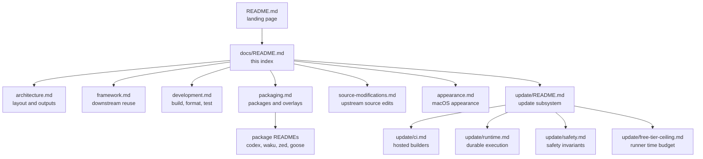

# Documentation index

This directory holds the repository documentation. Each document has one topic.
Read the document that matches the task, then follow its internal links.

## Document map

## Documents

| Document                                                   | Topic                                                              |
| ---------------------------------------------------------- | ------------------------------------------------------------------ |
| [architecture.md](architecture.md)                         | Repository layout, flake outputs, module layers, and the CLI       |
| [framework.md](framework.md)                               | Public API version 2, exported modules, and downstream usage       |
| [development.md](development.md)                           | Dev shell, formatting, quality gates, and the test strategy        |
| [packaging.md](packaging.md)                               | Package and overlay discovery, crate2nix packages, app packaging   |
| [source-modifications.md](source-modifications.md)         | Decision ladder for editing unpacked upstream source trees         |
| [interactive-toolchains.md](interactive-toolchains.md)     | Go, uv, and Python toolchains selected for George's Darwin profile |
| [appearance.md](appearance.md)                             | macOS appearance bridging for tools without paired-theme settings  |
| [update/README.md](update/README.md)                       | Update pipeline, entry points, and promotion boundary              |
| [update/ci.md](update/ci.md)                               | Update workflow on disposable GitHub-hosted builders               |
| [update/runtime.md](update/runtime.md)                     | Durable execution, admission, scheduling, and observability        |
| [update/safety.md](update/safety.md)                       | Executable safety invariants, each with its owning code and test   |
| [update/free-tier-ceiling.md](update/free-tier-ceiling.md) | Measured Update wall clock against the free-tier runner ceiling    |

## Reading paths

Use one of these paths to reach the relevant document quickly:

- **Build or apply a host.** Start at [architecture.md](architecture.md), then
  run the commands in the root [README.md](../README.md).
- **Change a package or overlay.** Start at [packaging.md](packaging.md), then
  read [source-modifications.md](source-modifications.md) before any source
  edit.
- **Debug an update or a CI failure.** Start at
  [update/README.md](update/README.md), then open
  [update/ci.md](update/ci.md) for hosted builders or
  [update/runtime.md](update/runtime.md) for local execution.
- **Add or change a test.** Read the testing strategy in
  [development.md](development.md) first: Nix logic is tested in `tests/nix/`,
  Python in pytest, and configuration data is not tested at all.
- **Review update safety.** Read [update/safety.md](update/safety.md) before
  changing any code that the invariants name.
- **Consume this flake elsewhere.** Read [framework.md](framework.md).

## Documents outside this directory

Some documents stay beside the code they describe:

- Package and overlay notes: [`packages/codex/README.md`](../packages/codex/README.md),
  [`packages/waku/README.md`](../packages/waku/README.md),
  [`packages/zed-editor-nightly/README.md`](../packages/zed-editor-nightly/README.md),
  [`overlays/goose-cli/README.md`](../overlays/goose-cli/README.md).
- Schema contracts: [`schemas/codegen/README.md`](../schemas/codegen/README.md)
  and [`schemas/codegen/LOCKFILE_SPEC.md`](../schemas/codegen/LOCKFILE_SPEC.md).
- Agent rules: [`AGENTS.md`](../AGENTS.md).

## Conventions

- The prose follows ASD-STE100 style: short sentences, active voice, and one
  topic per paragraph. See the [ASD-STE100 standard](https://www.asd-ste100.org/).
- Code, commands, paths, identifiers, hashes, and measured values are fixed
  text. A wording change must not alter them.
- Internal links are relative. External links point to the authoritative source
  for a concept.
- Diagrams use [Mermaid](https://mermaid.js.org/) and render on GitHub.
- `nix fmt` formats these files with [mdformat](https://github.com/hukkin/mdformat)
  and the GFM plugin. Run `nix fmt` after an edit.
