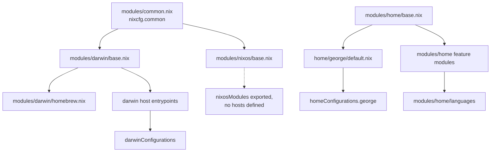

# Architecture

This document describes the repository layout, the flake outputs, and the
module layers. Read [framework.md](framework.md) for downstream reuse, and
[development.md](development.md) for the build and test workflow.

## Purpose

The repository is a personal `nix-darwin` and Home Manager flake with three
additional surfaces:

- reusable `darwin`, `home`, and `nixos` module sets for other repositories
- a Python `nixcfg` CLI for update, CI, recovery, and schema work
- custom packages and overlays under `packages/` and `overlays/`

## Inputs

`flake.nix` pins every external input. Some pins are deliberate operational
workarounds for upstream breakage. Do not remove a pin without finding out why
it exists.

| Input                 | Role                                                       |
| --------------------- | ---------------------------------------------------------- |
| `nixpkgs`             | Primary package set (`nixos-unstable`)                     |
| `nixpkgs-swift`       | Pinned package set with a working Swift build              |
| `nix-darwin`          | Darwin system configuration                                |
| `home-manager`        | User configuration                                         |
| `flakelight`          | Flake output scaffolding                                   |
| `devshell`            | Development shell                                          |
| `treefmt-nix`         | Formatter wiring for `nix fmt`                             |
| `nix-homebrew`        | Homebrew tap and cask management, with a pinned `brew-src` |
| `nix-rosetta-builder` | Rosetta builder for Linux builds on Apple silicon          |
| `git-hooks`           | Generated `.pre-commit-config.yaml`                        |
| `stylix`, `nixvim`    | Theming and editor configuration                           |

Package-source inputs, such as `emdash`, `gitbutler`, and `scratch`, set
`flake = false` and provide source trees only.

## Repository layout

| Path                     | Contents                                              |
| ------------------------ | ----------------------------------------------------- |
| `flake.nix`              | Inputs, outputs, systems, and the formatter           |
| `default.nix`, `lib.nix` | Public API entrypoints                                |
| `darwin/`                | Host entrypoints: `argus`, `rocinante`, `zeus`        |
| `home/`                  | User configuration, including `home/george/`          |
| `modules/`               | Reusable module sets                                  |
| `packages/`              | Standalone `callPackage` derivations, auto-discovered |
| `overlays/`              | Package overrides and source pinning, fragment-based  |
| `lib/`                   | Python tooling, Nix helpers, and update/CI logic      |
| `schemas/`               | Vendored JSON schemas and codegen specifications      |
| `tests/nix/`             | Nix-level tests for the exported API                  |
| `nixcfg.py`              | Typer CLI entrypoint                                  |
| `docs/`                  | This documentation                                    |

The host entrypoints are intentionally thin. Shared behavior belongs in
`modules/`, `lib/lib.nix`, `default.nix`, or `lib/exports.nix`, unless the change
is truly machine-specific.

## Module layers

Module sets:

- `modules/common.nix` defines `nixcfg.common`, the shared option surface.
- `modules/darwin/` holds the Darwin base module and Homebrew wiring.
- `modules/nixos/` holds the NixOS base module.
- `modules/home/` holds Home Manager modules, including the language modules
  under `modules/home/languages/`.

`lib/exports.nix` is the canonical module inventory. Add a module to that file
before you export it.

## Flake outputs

| Output                         | Contents                                         |
| ------------------------------ | ------------------------------------------------ |
| `darwinConfigurations.<host>`  | `argus`, `rocinante`, and `zeus`                 |
| `homeConfigurations.george`    | The standalone Home Manager configuration        |
| `packages.<system>.<name>`     | Auto-discovered packages from `packages/`        |
| `overlays`                     | Fragment-based overlays plus helper overlays     |
| `checks.<system>.*`            | Repo checks, formatter checks, and root closures |
| `legacyPackages.<system>`      | The package set with overlays applied            |
| `apps.<system>.nixcfg`         | The `nixcfg` CLI                                 |
| `formatter.<system>`           | The `treefmt` wrapper used by `nix fmt`          |
| `darwinModules`, `homeModules` | Exported module sets for downstream use          |
| `nixosModules`                 | Exported, but no `nixosConfigurations` exist     |

Exported systems: `aarch64-darwin`, `aarch64-linux`, and `x86_64-linux`. Keep
the platform guards. Many recurring failures in this repository come from
platform-specific drift.

## Host entrypoints

Each host file selects a profile and imports the shared modules:

- `darwin/argus.nix`
- `darwin/rocinante.nix`
- `darwin/zeus.nix`

`home/george/default.nix` is the user entrypoint. `home/george/configuration.nix`
holds the personal policy that the shared modules must not absorb, such as the
Zen chrome theme source.

## CLI

`nixcfg.py` exposes a Typer CLI. Every group loads lazily.

| Group     | Purpose                                                   |
| --------- | --------------------------------------------------------- |
| `update`  | Refresh source versions, hashes, and flake input refs     |
| `ci`      | Package maintenance, crate2nix pipelines, and CI commands |
| `schema`  | Nix JSON schema fetch, codegen, and verification          |
| `recover` | Recover tracked files from realised generation snapshots  |
| `actions` | GitHub Actions workflow discovery and live-tail helpers   |
| `tree`    | Print the full command tree                               |

Run `nix run .#nixcfg -- tree` to list every command.

## Where to look first

| Symptom                             | Start at                                                   |
| ----------------------------------- | ---------------------------------------------------------- |
| A host build fails                  | The failing derivation, then `packages/`                   |
| A package or overlay fails          | `packages/registry.nix`, then the derivation               |
| An update or CI job fails           | [update/README.md](update/README.md)                       |
| A hash or generated artifact drifts | The owning `sources.json`, `uv.lock`, or `Cargo.nix`       |
| An exported module changes          | `lib/exports.nix` and `tests/nix/default-api/`             |
| OpenCode or MCP wiring changes      | `modules/home/opencode.nix`, `home/george/mcp-catalog.nix` |

## Related

- [framework.md](framework.md): public API, constructors, downstream example
- [development.md](development.md): dev shell, formatting, tests, quality gates
- [packaging.md](packaging.md): package and overlay discovery
- [update/README.md](update/README.md): update subsystem
- [AGENTS.md](../AGENTS.md): agent-facing rules for this repository
