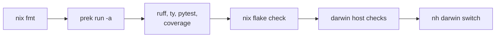

# Development

This document covers the development shell, formatting, quality gates, and the
validation ladder. Read [architecture.md](architecture.md) for the layout, and
[packaging.md](packaging.md) for package work.

## Development shell

```bash
# Enter the dev environment (tooling plus pre-commit hooks)
nix develop

# Keep Python tooling in sync for editor and test workflows
uv sync
```

Python is 3.14 or newer.

## Formatting

`nix fmt` runs the `treefmt` wrapper. It formats Nix, Python, shell, YAML, TOML,
JSON, Go, protobuf, and Markdown. Run it after every edit.

The Markdown pass uses [mdformat](https://github.com/hukkin/mdformat) with the
GFM plugin and the frontmatter plugin. Skill files keep their YAML frontmatter.

Do not hand-edit `.pre-commit-config.yaml`. `git-hooks.nix` generates it from
`flake.nix`.

## Pre-commit hooks

```bash
prek run -a
```

Rules:

- Do not use `--no-verify` with `git commit`, `git push`, or a related flow.
- If a hook fails, fix the cause, or stop and ask.
- Do not push while a required local gate fails.
- Before a push, run `prek run -a` or the relevant CI-parity commands on the
  final tree.

## Commit conventions

Use [Conventional Commits](https://www.conventionalcommits.org/). `commitlint`
enforces the format. Recent subjects use these prefixes:

- `fix(ci)`, `fix(update)`, `fix(packages)`
- `feat(packages)`
- `refactor(update)`
- `chore`

Sign a commit with `git commit -S` when the user asks for a commit.

## Python quality gates

```bash
uv run ruff check --config pyproject.toml .
uv run ty check .
uv run pytest
uv run coverage run -m pytest && uv run coverage report
```

Quality bar:

- Ruff runs with an aggressive rule set.
- `ty` warnings fail the check.
- The coverage floor is 100 percent.

Coverage exclusion policy:

- The floor stays at 100 percent.
- A line or branch may carry `# pragma: no cover -- <reason>` or
  `# pragma: no branch -- <reason>`. The reason is mandatory.
- An exclusion is valid only when a test merely restates the implementation.
  Examples:
  - a defensive re-raise
  - a `__main__` guard
  - an abstract method body
  - a platform branch that CI cannot execute
- If a branch can fail in a meaningful way, write a behavioral test instead. If
  a branch cannot execute at all, consider deleting it.
- A whole-module exemption requires a commented entry in `pyproject.toml`.
- Do not mock every collaborator just to walk a line.

Mutation testing:

```bash
uv run cosmic-ray init cosmic-ray.toml .cosmic-ray.sqlite
uv run cosmic-ray exec cosmic-ray.toml .cosmic-ray.sqlite
uv run cr-report .cosmic-ray.sqlite
```

## Testing strategy

Tests are split by the language of the code that can be wrong. There is one
crossing point: Python that *emits* Nix. Everywhere else, a test lives in the
language of the implementation.

| Lane              | Code                                                                                     | Owned by                          | Form                                              |
| ----------------- | ---------------------------------------------------------------------------------------- | --------------------------------- | ------------------------------------------------- |
| Nix unit          | `lib/*.nix`, `modules/**`, `overlays/_lib/**`, `darwin/george/dock-lib.nix`              | `tests/nix/*.nix`                 | evaluation against synthetic fixtures             |
| Nix configuration | `darwin/*.nix`, `darwin/<host>/**`, `home/george/**`, package lists                      | the host build                    | `nix flake check`, `nh darwin switch`             |
| Python unit       | `lib/update/**`, `lib/nix/**`, `lib/macos/**`, `lib/recover/**`, `lib/schema_codegen/**` | `lib/tests/*.py`                  | pure pytest with `tmp_path` and mocked boundaries |
| Package updater   | `packages/**/updater.py`, `overlays/**/*updater*.py`                                     | `packages/<name>/updater_test.py` | mocked upstream calls, ASTs of generated Nix      |
| Emission contract | Python that writes Nix                                                                   | `lib/tests/*.py`                  | parse the emitted output, compare ASTs            |
| Reader contract   | Python that reads repo Nix structure                                                     | one `nix_eval` test per reader    | cross-check the parser against Nix                |

### The boundary

**Do not test configuration data.** A host or user configuration file is data.
Its correctness is established by evaluating and activating the host, and by
review. A test that duplicates a config value only guarantees that every config
edit costs a second edit.

The rule that follows from this:

- No pytest module in the suite may read a `.nix` file under `darwin/` or
  `home/george/`, or name one of those directories. That covers `lib/tests/`
  and the package- and overlay-owned `updater_test.py` files;
  `lib/tests/test_suite_boundary.py` fails the run if one does.
- Configuration edits must never require a test edit. If they do, the test is
  wrong even when it currently passes.
- When a configuration really needs a guard, assert an *invariant* that holds
  for any valid configuration, not a *snapshot* of the current one. Compare
  `tests/nix/mac-apps/dock-declarations.nix` (every Dock entry is a system app
  or a resolved bundle) with a list of every Dock entry.
- Assertions must be able to fail. A negative guard whose subject is absent, or
  a membership test against the wrong container, passes silently forever. Prove
  a new assertion fails when you break the code.

`lib/tests/test_mac_apps_nix.py` now holds only what belongs in Python:

- behaviour of the Python activation helper,
- scripts the test renders and then executes,
- structural assertions on generated bash through `lib/tests/_shell_ast.py`,
  because Nix has no bash parser,
- a few decisions no build can express: one unified ChatGPT bundle, the Twilight
  AutoConfig path that keeps its quit dialog working, and the Zed Nightly
  dynamic-pipe installer.

Everything that asserted the *shape* of a Nix expression now lives in
`tests/nix/mac-apps/`. One exception remains:
`test_prebuilt_app_helpers_preserve_signed_resources_by_default` reads the
default of a helper's `dontFixup` formal. Nix cannot observe a default argument
without applying the builder to a full `stdenv` stub, which would assert the
stub rather than the helper.

When you add a test, ask which file you would have to edit to break it without
changing anything a user notices. If the answer is a Nix declaration, the test
belongs in `tests/nix/`.

### Nix test rules

- Prefer an eval-only check. A check that needs a build must justify the build.
- Import shared assertions from `tests/nix/lib.nix`; do not paste `assertEq`.
- Assert on evaluated values: option values, rendered scripts parsed with
  `lib/tests/_shell_ast.py`, or an expected `throw` via `assertThrows`.
- Do not assert on the source text of the module under test. A `let`-binding
  name is not a contract.
- A library test builds its own fixture. It does not import a real host.
- Never hash rendered output. A golden hash fails on a cosmetic edit and reports
  no diff; assert the property the hash was standing in for.
- Every test is reachable. A file under `tests/nix/` that no flake check, hook,
  or document names is dead weight and rots silently.

### Opt-in integration probes

A few probes build a complete package graph and are far too expensive for the
default check graph. They live beside the package and run on demand:

```bash
nix eval --offline --impure --option allow-import-from-derivation false --json \
  --file packages/gitbutler/tests/native-input-cache-boundary.nix
nix eval --offline --impure --option allow-import-from-derivation false --json \
  --file packages/gitbutler/tests/native-override-policy.nix
nix eval --offline --impure --option allow-import-from-derivation false --json \
  --file packages/zed-editor-nightly/tests/native-override-policy.nix
```

Keep this list accurate. Anything not named here should become a wired check or
be removed; a probe that no longer evaluates is deleted, not left behind.

### Python test rules

Python tests are the executable specification for maintained Python behavior.
Cover success paths, failure paths, and edge cases. Treat an uncovered branch as
a missing test or a design smell.

Use this order:

1. Pure Python unit tests.
1. Nix AST assertions with `nix-manipulator`, on Nix that Python produced.
1. Mocked Python-side subprocess or wrapper tests.
1. Real Nix evaluation only when the property cannot be established above.

- Test generated Nix structurally. Prefer AST equality over string equality,
  unless the rendered text is itself the contract.
- Do not assert that a source file contains or omits a raw string fragment.
  Parse the source instead: Nix ASTs for Nix, `ast` or `libcst` for Python,
  format parsers for data files.
- Keep substring assertions for presentation output only, where the text is the
  user-facing contract.
- Do not use Nix evaluation to prove that Python emitted the right Nix. Parse
  the output and compare ASTs, or refactor the production code toward explicit
  AST builders.
- Mock `run_nix`, `run_nix_json`, or `subprocess.run` to cover control flow,
  argument construction, parsing, timeouts, and failures.
- A package-owned updater test belongs beside its package as
  `packages/<name>/updater_test.py`.

A test that needs real Nix evaluation uses the shared `lib.tests._nix_eval`
helper and declares `@pytest.mark.nix_eval(reason="Why evaluation is necessary")` locally. The helper rejects unmarked execution and enforces a
30-second timeout. Keep the expression limited to the semantic unit under test.
Host and closure checks belong in the native Nix checks.

Any new eval-based test needs a short docstring or comment that explains why
AST-only or pure-Python testing was insufficient.

## Schema contracts

Vendored Nix schemas define the wire contract. The public Python models keep
construction defaults, legacy full store paths, and ergonomic views of
experimental data. `lib/tests/test_nix_model_contracts.py` checks their fields,
enums, scalar constraints, numeric bounds, and deliberate compatibility
differences against those schemas.

Generated bindings are reference artifacts. `nixcfg schema verify` checks their
freshness. Freshness alone does not prove that the public models conform.

## Nix checks

```bash
# Formatting and evaluation
nix fmt
nix flake check --no-build --option allow-import-from-derivation false
nix flake check --all-systems --no-build --option allow-import-from-derivation false
nix flake check

# Host checks
nix build .#checks.aarch64-darwin.darwin-argus
nix build .#checks.aarch64-darwin.darwin-rocinante
nix build .#checks.aarch64-darwin.darwin-zeus
nix build .#homeConfigurations.george.activationPackage

# Package-focused work
nix build .#pkgs.<system>.<name>

# CSS and web assets
nix build .#checks.x86_64-linux.format-web-oxfmt
nix build .#checks.x86_64-linux.lint-web-oxlint
```

Apply a Darwin configuration locally only when the task truly requires it:

```bash
nh darwin switch --no-nom .#
```

## Validation ladder

Use the narrowest relevant check first.



Additional update and artifact checks:

- `uv run python -m lib.update.ci.crate2nix`
- `nix run .#nixcfg -- ci --help`
- `nix run .#nixcfg -- update --help`

## Related

- [architecture.md](architecture.md): layout and outputs
- [packaging.md](packaging.md): package and overlay discovery
- [source-modifications.md](source-modifications.md): upstream source edits
- [update/README.md](update/README.md): update subsystem
- [AGENTS.md](../AGENTS.md): full agent-facing rule set
