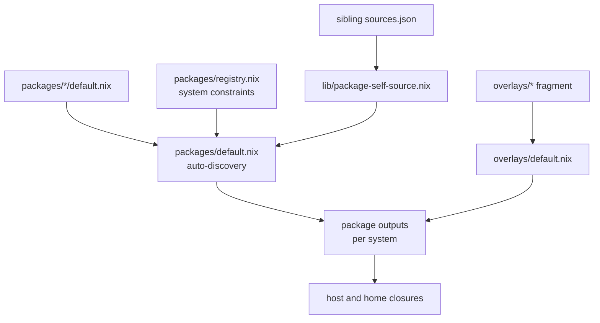

# Packaging

This document describes package and overlay discovery, the shared source
plumbing, the crate2nix pattern, and the macOS app packaging pattern. Read
[source-modifications.md](source-modifications.md) before you edit an upstream
source tree.

## Packages and overlays

Use `packages/` for a standalone `callPackage` derivation. Use `overlays/` when
you need `final` or `prev` semantics, or when you override nixpkgs behavior.



Rules:

- `packages/default.nix` auto-discovers packages. `packages/registry.nix` holds
  system constraints.
- A companion `crate2nix-src.nix` entry is discovered and exported too.
- `overlays/default.nix` auto-imports overlay fragments and combines them with
  the helper overlays.
- If you add or rename a package, check discovery and system constraints, not
  only the derivation.
- Keep platform guards. Do not weaken them casually.

## Sibling source plumbing

The repository centralizes sibling `sources.json` injection through
`lib/package-self-source.nix`, `default.nix`, and `packages/default.nix`. If a
package expects `selfSource`, use the shared helper. Do not invent a one-off
path.

Generated artifacts are machine-maintained. Do not hand-edit `sources.json`,
`uv.lock`, `Cargo.nix`, `crate-hashes.json`, or `packages/superset/bun.nix`
unless the task is regeneration.

Drift in a generated artifact is a first-class failure. Common examples:

- `sources.json` or `overlays/*/sources.json` drift
- `uv.lock` drift
- `Cargo.nix` or `crate-hashes.json` drift
- a hash mismatch in `npmDepsHash`, `denoDepsHash`, or `vendorHash`

## Adding or updating a package

Check these locations first:

- `packages/registry.nix` for system constraints
- a similar existing package in `packages/` or `overlays/`
- `packages/default.nix` for discovery
- `lib/package-self-source.nix` for sibling `sources.json` plumbing

For a source-backed package, keep the whole pattern coherent:

- the derivation file
- `sources.json` when the pin needs one
- `updater.py` when the version advances automatically
- a system constraint in `packages/registry.nix` when the package is not
  universal
- a validation build for the real target platform

## crate2nix packages

Rust workspaces that need a cacheable per-crate graph use
[crate2nix](https://github.com/nix-community/crate2nix). Examples in this
repository:

- [`packages/codex/README.md`](../packages/codex/README.md)
- [`packages/zed-editor-nightly/README.md`](../packages/zed-editor-nightly/README.md)
- [`overlays/goose-cli/README.md`](../overlays/goose-cli/README.md)

Shared shape:

- The crate2nix pipeline generates `Cargo.nix` and `crate-hashes.json`, and the
  repository checks them in. The build does not generate them.
- `default.nix` is hand-maintained. It holds update-time source preparation,
  build-time patches, crate overrides, install phases, and the final assembly.
- `normalize_cargo_nix.py` is a pure package-specific callback. The central
  crate2nix normalizer loads it.
- `updater.py` advances the locked source and records the revision.
- Evaluation imports the checked-in `Cargo.nix` against the evaluator-visible
  flake input. Evaluation never realizes the prepared source tree.
- Per-crate source filters stay in place, so an unrelated workspace change does
  not invalidate every local crate.

Regenerate the graph after a source or lockfile change:

```bash
nix run .#nixcfg -- ci pipeline crate2nix --write --package <name>
```

The `.#` form evaluates the Git-tracked source set. Stage a new or renamed
artifact before you invoke it, so Nix can see it.

Validate the package with the crate2nix pipeline and a real build:

```bash
nix run .#nixcfg -- ci pipeline crate2nix --package <name>
nix eval --option allow-import-from-derivation false --raw .#<name>.drvPath
nix build .#<name> --no-link
```

## macOS app packaging

Use the shared Darwin app pattern for a macOS GUI app:

- `overlays/_lib/helpers/darwin-apps.nix`
- `lib/mac-apps.nix`
- `passthru.macApp`, built with the `mkMacAppPassthru` package helper
- `nixcfg.macApps.applications.<name>` with `scope = "system"` for
  `/Applications`

Do not add a bespoke activation hack for `/Applications` unless the shared
pattern genuinely cannot express the need.

### Application activation

`lib/mac-apps.nix` builds the activation body. `concurrentApplicationsScript`
takes every declared scope and runs them as background jobs in the one
nix-darwin activation shell, then waits for all of them before activation
continues. Scopes write disjoint target directories under separate target locks,
so `/Applications` and `~/Applications` overlap safely, and a failing scope still
fails activation.

Inside the helper, `_stage_managed_apps` copies changed bundles through a bounded
pool, `_changed_application_entries` compares bundles concurrently, and the
post-commit LaunchServices and Spotlight refresh covers only the bundles that
were actually promoted. Promotion renames stay sequential on purpose: the
durable journal, not the copy, defines the crash-recovery order.

The user scope runs as the primary user, so `~/Applications` keeps user
ownership. `nixcfg.macApps.activationScope` decides who runs it:

- `"home-manager"` (default) keeps the dedicated Home Manager activation step.
- `"nix-darwin"` means system activation already ran the same entries
  concurrently, so the Home Manager step is skipped.

A host that enables the handoff declares it next to its apps:

```nix
macApps = {
  applications = routing;
  activationScope = "nix-darwin";
};
```

### Command-line executables bundled inside an application

Declare `cli` on the routing entry to put a bundled executable on PATH. The path
stays bundle-relative, so the resolved route keeps deciding which copy of the
bundle is authoritative:

```nix
zed = {
  package = pkgs.zed-editor-nightly;
  cli.zed.path = "Contents/MacOS/cli";
};
```

The `nixcfg.macApps` module in `modules/home/darwin.nix` links each command into
`~/.local/bin` through `home.file`. Importing `lib/mac-apps.nix` on its own only
exposes `cliShimFiles`; the module performs the projection. Every shim is a
generated script that execs the resolved bundle path, because a `home.file`
source pointing straight at `~/Applications` would be an impure path at
evaluation time. That also keeps shims invisible to the `home.packages` overlap
assertion and the profile bundle-leak audit, which inspect package outputs rather
than home files. Putting `~/.local/bin` on PATH stays the consumer's job.

Declaring `env` adds export lines to the shim. Use it when the executable needs
environment that the bundle does not set for itself:

```nix
tailscale = {
  package = pkgs.tailscale-app;
  scope = "system";
  cli.tailscale = {
    path = "Contents/MacOS/Tailscale";
    env.TAILSCALE_BE_CLI = "1";
  };
};
```

Command names must be unique across applications and must be plain file names;
paths must be bundle-relative; env names must be shell identifiers.
`cliConfigError` in `lib/mac-apps.nix` reports each mistake at evaluation time.
Nothing checks that the executable exists, so a moved or missing bundle degrades
to an `exit 127` with a message on first use.

`home.file` refuses to overwrite a file or symlink it does not own, so a
`~/.local/bin/<command>` left behind by something other than `home.file` fails
activation with `would be clobbered` instead of being replaced. When retiring a
bespoke activation that created such links, remove them first, as
`nixcfgDropLegacyBundledCodexLinks` in `home/george/darwin.nix` does.

This mechanism covers executables that ship *inside* the bundle. A standalone
store binary, such as GitButler's `but`, stays a plain `home.file` link to
`${pkgs.gitbutler}/bin/but`.

### Release channels

Some upstreams publish a nightly channel beside their stable one, using tags a
version parser cannot read, for example T3 Code's
`v0.1.3-nightly.20261025.3655`. Pin such an input to the channel tag, not the
branch: the tag is immutable, and it carries the release version the app uses to
select its update channel. `lib/update/refs.py` advances these refs within their
own series, so a nightly pin never resolves back to the newest stable release.

The channel then has to reach the packaged bundle, or the app identifies itself
as stable:

- package name, icon, and bundle identifier come from the channel, mirroring the
  upstream packaging script
- the version reaches `Info.plist`, the app manifest, and any CLI shim
- URL schemes stay the ones the shipped app actually answers on

`packages/t3code-desktop` demonstrates the whole path, including staged channel
artwork and `verify_bundle_identity.py`, which fails the build when the bundle
metadata drifts.

## Related

- [source-modifications.md](source-modifications.md): policy for upstream edits
- [development.md](development.md): Dev shell, checks, and quality gates
- [architecture.md](architecture.md): layout and outputs
- [update/README.md](update/README.md): update pipeline and artifact refresh
- [AGENTS.md](../AGENTS.md): packaging rules for agents
