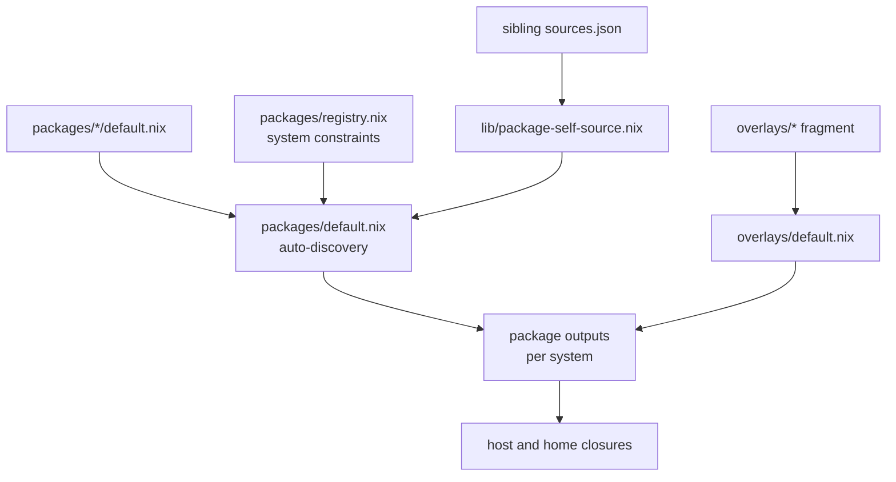

# Packaging

This document describes package and overlay discovery, the shared source
plumbing, the crate2nix pattern, and the macOS app packaging pattern. Read
[source-modifications.md](source-modifications.md) before you edit an upstream
source tree.

## Packages and overlays

Use `packages/` for a standalone `callPackage` derivation. Use `overlays/` when
you need `final` or `prev` semantics, or when you override nixpkgs behavior.



Rules:

- `packages/default.nix` auto-discovers packages. `packages/registry.nix` holds
  system constraints.
- A companion `crate2nix-src.nix` entry is discovered and exported too.
- `overlays/default.nix` auto-imports overlay fragments and combines them with
  the helper overlays.
- If you add or rename a package, check discovery and system constraints, not
  only the derivation.
- Keep platform guards. Do not weaken them casually.

## Sibling source plumbing

The repository centralizes sibling `sources.json` injection through
`lib/package-self-source.nix`, `default.nix`, and `packages/default.nix`. If a
package expects `selfSource`, use the shared helper. Do not invent a one-off
path.

Generated artifacts are machine-maintained. Do not hand-edit `sources.json`,
`uv.lock`, `Cargo.nix`, `crate-hashes.json`, or `packages/superset/bun.nix`
unless the task is regeneration.

Drift in a generated artifact is a first-class failure. Common examples:

- `sources.json` or `overlays/*/sources.json` drift
- `uv.lock` drift
- `Cargo.nix` or `crate-hashes.json` drift
- a hash mismatch in `npmDepsHash`, `denoDepsHash`, or `vendorHash`

## Adding or updating a package

Check these locations first:

- `packages/registry.nix` for system constraints
- a similar existing package in `packages/` or `overlays/`
- `packages/default.nix` for discovery
- `lib/package-self-source.nix` for sibling `sources.json` plumbing

For a source-backed package, keep the whole pattern coherent:

- the derivation file
- `sources.json` when the pin needs one
- `updater.py` when the version advances automatically
- a system constraint in `packages/registry.nix` when the package is not
  universal
- a validation build for the real target platform

## crate2nix packages

Rust workspaces that need a cacheable per-crate graph use
[crate2nix](https://github.com/nix-community/crate2nix). Examples in this
repository:

- [`packages/codex/README.md`](../packages/codex/README.md)
- [`packages/zed-editor-nightly/README.md`](../packages/zed-editor-nightly/README.md)
- [`overlays/goose-cli/README.md`](../overlays/goose-cli/README.md)

Shared shape:

- The crate2nix pipeline generates `Cargo.nix` and `crate-hashes.json`, and the
  repository checks them in. The build does not generate them.
- `default.nix` is hand-maintained. It holds update-time source preparation,
  build-time patches, crate overrides, install phases, and the final assembly.
- `normalize_cargo_nix.py` is a pure package-specific callback. The central
  crate2nix normalizer loads it.
- `updater.py` advances the locked source and records the revision.
- Evaluation imports the checked-in `Cargo.nix` against the evaluator-visible
  flake input. Evaluation never realizes the prepared source tree.
- Per-crate source filters stay in place, so an unrelated workspace change does
  not invalidate every local crate.

Regenerate the graph after a source or lockfile change:

```bash
nix run .#nixcfg -- ci pipeline crate2nix --write --package <name>
```

The `.#` form evaluates the Git-tracked source set. Stage a new or renamed
artifact before you invoke it, so Nix can see it.

Validate the package with the crate2nix pipeline and a real build:

```bash
nix run .#nixcfg -- ci pipeline crate2nix --package <name>
nix eval --option allow-import-from-derivation false --raw .#<name>.drvPath
nix build .#<name> --no-link
```

## macOS app packaging

Use the shared Darwin app pattern for a macOS GUI app:

- `overlays/_lib/helpers/darwin-apps.nix`
- `lib/mac-apps.nix`
- `passthru.macApp`
- `nixcfg.macApps.systemApplications`

Do not add a bespoke activation hack for `/Applications` unless the shared
pattern genuinely cannot express the need.

## Related

- [source-modifications.md](source-modifications.md): policy for upstream edits
- [development.md](development.md): Dev shell, checks, and quality gates
- [architecture.md](architecture.md): layout and outputs
- [update/README.md](update/README.md): update pipeline and artifact refresh
- [AGENTS.md](../AGENTS.md): packaging rules for agents
