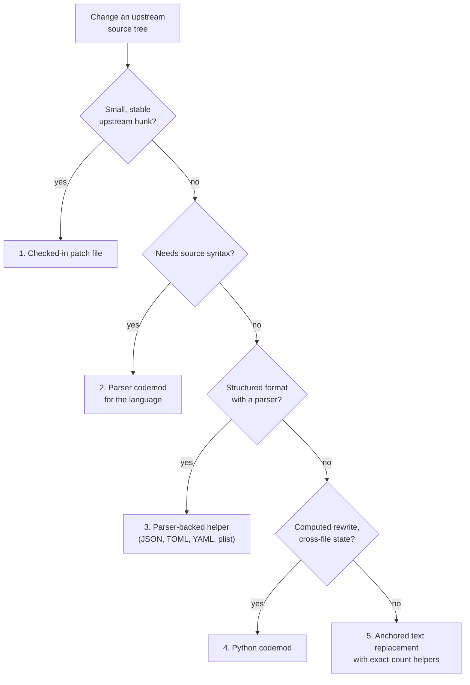

# Source modification policy

This repository packages upstream source trees. Every change to an unpacked
upstream source tree must use the smallest mechanism that stays reviewable and
fails loudly when upstream changes shape.

Read [packaging.md](packaging.md) for package discovery and the crate2nix
pattern. Read [development.md](development.md) for the test workflow.

## Decision ladder



The ladder in order:

1. Use a checked-in patch file for a small, stable upstream hunk.
1. Use a structured parser codemod for a source or data format when the edit
   needs syntax.
1. Use parser-backed helpers for data formats such as JSON, TOML, YAML, and
   plist.
1. Use a Python codemod for computed rewrites, cross-file state, copied assets,
   or package orchestration.
1. Use anchored text replacement only as a last resort, and only through
   exact-count helpers.

## Layout

Package-specific codemods live beside the package or overlay they patch:

```text
packages/example/codemods/
  rewrite_upstream.py
```

Reusable mechanics live under `lib/codemods/`. Keep a package-local script thin:
it describes what it changes. A shared helper owns how the change is validated.

`lib/tests/test_packaging_source_modification_policy.py` keeps a baseline of
existing ad hoc package and overlay rewrites. A new rewrite fails in pytest
until it uses these mechanisms or is accepted as migration debt.

## Source code

Use the smallest parser or exact-count helper that preserves the upstream-shape
check. Do not add a new parser dependency for one stable hunk. Use
`lib.codemods.text` when an anchored snippet is enough:

```sh
python - <<'PY'
from pathlib import Path

from lib.codemods.text import regex_replace_file_exactly

regex_replace_file_exactly(
    Path("src/main.rs"),
    pattern=r"config\.include\((?P<path>[^)]+)\);",
    replacement=r"config.include_path(\g<path>);",
    expected_count=1,
)
PY
```

## Structured data

Do not use ast-grep or raw string replacement for JSON, TOML, YAML, plist, or
lock-like data when a parser is available. Use a parser-backed helper instead.
Preserve stable formatting and assert the semantic shape that changes.

## Text fallbacks

If a format has no practical parser and a patch file is not appropriate, use the
helpers from `lib.codemods.text`. State the expected replacement count
explicitly. A missing or duplicate anchor is an upstream-shape failure, not a
silent no-op.

## Related

- [packaging.md](packaging.md): package discovery and crate2nix packages
- [development.md](development.md): formatting, tests, and quality gates
- [architecture.md](architecture.md): repository layout
- [`lib/codemods/`](../lib/codemods): shared rewrite helpers
