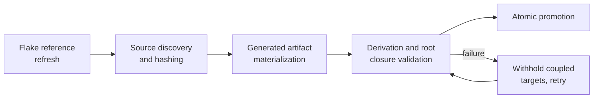

# Update subsystem

The update subsystem refreshes source versions, hashes, and flake input refs.
It prepares one disposable candidate, validates that candidate, and then
promotes it atomically. This document is the overview. Read
[ci.md](ci.md), [runtime.md](runtime.md), and [safety.md](safety.md) for the
detail.

## Pipeline



## Local execution

```bash
nixcfg update                 # prepare, validate, promote
nixcfg update --check         # prepare and validate, skip promotion
nixcfg update --patch PATH    # export the successful candidate
nixcfg update --status        # report the latest or a named run
nixcfg update --resume RUN_ID # resume an interrupted run
```

`nixcfg update` prepares changes in an isolated copy of the checkout. Every run
that changes the checkout must first build all configured root closures. A
root closure contains a system or Home Manager configuration and all its
dependencies. A candidate identical to the checkout changes nothing, so it skips
the build gate.

Root discovery follows `darwin/*.nix`, `nixos/*.nix`, and `home/*/default.nix`.
It does not require a separate list of host names.

When a root build fails, the updater leaves the candidate changes outside the
checkout. The updater also rejects source changes that invalidate the tested
snapshot. It preserves existing user edits and does not activate a
configuration.

## Target promotion

Targets are promoted individually. A failing target is withheld together with
the targets coupled to it:

- companion and aggregate sources
- every target hashed against the same flake input, when that input moved during
  the run

`flake.nix` and `flake.lock` revert as a unit. The remaining candidate is
validated again, at most three rounds, and then promoted. Any failure still sets
a non-zero exit status. The summary lists updated, withheld, and failed targets
separately. `--strict` restores the all-or-nothing behavior: any failure
discards every candidate.

## Hash freshness

A full update requires valid, current hashes for every requested platform. When
recomputation is needed, a failed Linux hash probe cannot count as success by
retaining its previous hash. Use `--native-only` to request only the current
platform explicitly.

Freshness checks require all requested hashes and include each platform's
derivation fingerprint. A Darwin fingerprint cannot hide Linux-only changes.
Existing multi-platform sources with a native-only fingerprint are refreshed
once to establish the complete fingerprint.

## Durable execution

Every CLI update is a DBOS workflow backed by one SQLite database per run:

```text
$XDG_STATE_HOME/nixcfg/update/runs/<run-id>/run.sqlite
```

`UPDATE_RUN_LOG_DIR` overrides the root. Resume an interrupted run with
`nixcfg update --resume RUN_ID`. The resume reuses the original inputs, the
completed source work, and the validation results, and it reconstructs candidate
files from SQLite. The original repository, platform, and updater runtime must
still match. Use a new invocation to retry a completed failure or to discover
newer releases.

`nixcfg update --status [RUN_ID]` reports the latest or a named run, including
DBOS execution status and heartbeat freshness. A pending workflow with stale
activity may be interrupted. It is not evidence of a live worker.

SQLite also holds structured diagnostics and status snapshots. These replace
`events.jsonl`, `run.json`, and `state.json`. `output.log` remains available for
tailing subprocess output. `UPDATE_RUN_LOG=0` disables detailed diagnostic
events and subprocess logging. Execution checkpoints and status remain durable.

Diagnostics redact URL credentials, query strings, and fragments. Legacy JSON
logs remain historical files and cannot be resumed. Retain the run directory to
retain recovery state.

## Progress and timings

Progress is visible by default. On a terminal, the live panel shows only the
targets currently in flight, with finished targets printed above it. It ends
with a status line that names the phase, the done, running, and failed counts,
and the longest-running target with its idle time.

Plain output, which covers pipes, `--tty off`, and Zellij, prints phase headers,
per-target results, and that status line every 30 seconds
(`UPDATE_HEARTBEAT_INTERVAL`). A target that produces no output for five minutes
(`UPDATE_INACTIVITY_WARNING_SECONDS`) is flagged as stalled. Add `--verbose` to
stream the underlying build logs.

Use `--timings`, optionally with `--json`, to inspect operation time, admission
waits, and cache reuse.

## Repair

For one bounded local repair attempt, use
`nixcfg update --repair codex TARGET`. Use `--repair copilot` with that CLI
installed and authenticated. Both agents work in a disposable copy of the
repository. Codex runs with `--sandbox workspace-write`. Copilot runs in that
directory with all tools allowed and no OS sandbox, so it can reach anything
your user can. Before promotion, the repair must stay inside the repair
allow-list and pass the checkPhase-skip check. A repair then starts fresh
execution and must pass updater validation, repository quality gates, and
root builds before atomic promotion.

`--check` keeps the result unapplied, and `--patch PATH` exports it. Normal
updates retain DBOS resume. Repair mode requires a fresh run and cannot be
combined with `--resume` or `--run-id`.

## Flake edits and timeouts

Flake edits refresh the lockfile once, through the same streaming command runner
as source refreshes. `--subprocess-timeout` applies to these commands as well as
to package and root validation. A command that hits the timeout is not retried.

## Toolchain metadata

Source-derived toolchain metadata comes from the pinned upstream manifests and
locks. Node and pnpm selection must satisfy upstream requirements through the
pinned nixpkgs package set. Mux and Superset use the exact Bun version from
`packageManager`, with updater-generated runtime hashes. The updater owns these
generated values. Reviewed compatibility pins and platform policy remain
explicit.

## CI execution

The [Update workflow](../../.github/workflows/update.yml) prepares one candidate
on disposable macOS ARM64, Linux ARM64, and Linux x86_64 builders. It validates
that candidate on all three, then proposes the changes in a pull request. Read [ci.md](ci.md) for
the job graph, credentials, and retry behavior.

## Related

- [ci.md](ci.md): hosted builders, job graph, credentials, failure handling
- [free-tier-ceiling.md](free-tier-ceiling.md): measured 5h06m no-skip wall clock vs the 2h54m skip-shards baseline, extra-time breakdown, and the unpaid GitHub Actions ceiling
- [runtime.md](runtime.md): admission, scheduling, and observability
- [safety.md](safety.md): safety invariants and their owning code
- [packaging.md](../packaging.md): artifact regeneration and package policy
- [README.md](../../README.md): install, apply, and CLI entry points
