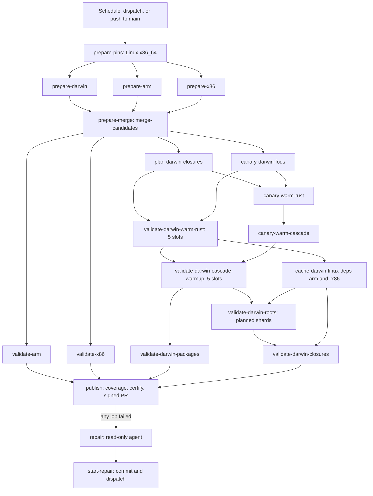

# Updater CI

The `Update` workflow uses disposable GitHub-hosted builders. It runs weekly on
Monday at 07:17 UTC and supports manual target selection. An empty selection
uses the CLI's eligible inventory. Bulk holds are part of that inventory.
Successful changes become a signed commit and a pull request. The workflow
does not apply a system configuration.

The workflow definition uses the [GitHub Actions workflow
syntax](https://docs.github.com/en/actions/reference/workflows-and-actions/workflow-syntax).
See [update safety invariants](safety.md) for the invariant list and
[update runtime and durable execution](runtime.md) for the execution model.

Concurrency is per Git ref. Default-branch runs stay queued. A feature-branch
exercise run cancels an older in-progress run, so a newer HEAD can start.

## Pipeline shape

The pipeline has four phases: prepare, validate, certify, and publish. The
diagram follows the `needs:` graph in `.github/workflows/update.yml`.



`publish` also needs `prepare-merge`, `plan-darwin-closures`, both warmups,
and `validate-darwin-roots`. `repair` needs every job above it, so it can
collect each failure. `canary-slots` reads `.github/update-kick` on a push or
the canary inputs on a dispatch. A canary dispatch runs the prepare/merge and
plan producers followed by the requested canary jobs; full validation and
publish stay skipped, so a green canary always has real current artifacts.

The workflow runs weekly on Monday at 07:17 UTC. A push to `main` that changes
`.github/update-kick` or `lib/update/**` also starts it, so a pipeline fix can
start Update without a kick-file bump.

## Execution and ownership

Three stages own the work: preparation, validation, and certification.

### Preparation

`prepare-pins` refreshes flake references and versions on Linux x86_64 and
keeps the existing hashes. A version bump without its hashes is not a legal
persist. The three native `prepare` jobs then compute their native hashes in
parallel from that pinned candidate. `prepare-merge` combines the three
results into one candidate. Each native job keeps the release metadata that
`prepare-pins` selected.

### Validation

Validation builds the final identical tree on all three native builders. The
two Linux validators run after `prepare-merge`. On Darwin, the rust and
cascade warmups fill `gkze` before the package and root jobs start, so the
five hosted macOS runners substitute shared outputs. The
`cache-darwin-linux-deps-*` jobs recache the Linux builder image that the
Darwin roots embed. Package evidence and closure evidence are separate
reports. Certification requires both gates for every system.

One hosted macOS job cannot realize `checks.aarch64-darwin.root-closures`
inside the 360-minute job cap. That build is therefore a chain of shards. Each
shard builds for five hours, the [Cachix](https://docs.cachix.org/) daemon
flushes, and the next shard substitutes those paths and continues.

CI retries a transient store fault (`Illegal byte sequence` or SIGBUS) with
only the time left in that shard's build budget. The build then continues the
same way: realized paths stay in `gkze` and the next shard substitutes them. A
real derivation failure (`error: builder for`, `error: Cannot build`, or a
failed dependency) still fails the shard. The last shard does not yield. An
unfinished closure or a store fault that survives the retry fails the run.

A completed real failure of a required sibling stops the jobs that can no
longer reach publish. `lib/update/sibling_failfast.py` owns that decision.
The watched conclusions are `failure`, `timed_out`, and `startup_failure`.
`cancelled` and `skipped` do not stop anyone. A device-faulted Darwin prepare
still completes successfully so the fresh VM can retry it. The stop exits the
updater process and leaves the Cachix flush in place. GitHub
`strategy.fail-fast` stays off because cancellation skips that flush.

`prepare-darwin`, `prepare-arm`, `prepare-x86`, and `prepare-darwin-retry`
watch each other. `prepare-darwin-<digits>` is the same watch name as
`prepare-darwin`, and `prepare-darwin-retry-<digits>` is
`prepare-darwin-retry`. Those ids are the public-pool Darwin prepare shards.
`prepare-darwin-merge` is not in the group. `prepare-pins` does not watch:
later stages have not started.
Linux prepare is the short hash check, and a failure there means Darwin's
remaining hashes cannot merge. Run 40577174548
had prepare-x86 fail at 11 minutes on gitbutler while prepare-darwin kept
hashing that target for another 35 minutes. `plan-darwin-closures` failure
stops `validate-arm` and `validate-x86`. Run 40494342241 planned for 6.5
minutes and validate-x86 kept building for 134. A validate failure does not
stop plan. Rust-warmup slots, cascade-warmup slots, and Darwin root shards
stop their own matrix cells. Run 39912925016 rust slot 0 failed at 262
minutes and the other slots ran until the 360-minute cap. A canary-rust
failure does not fail-close the 5-wide rust stripe. Prebuild and
cascade-canary failures stay non-gates. The poll interval is 60 seconds.
Publish still requires every validation job, the coverage assertion, and
certification. A green run still builds every closure.

Every declared package platform and every native root is still built. Shards
are serial because the closure's slow graph is shared. Parallel host builds
duplicate the same graph.

Each builder evaluates every declared package platform and builds native
package validations. Each builder builds its roots from the independently
checked root manifest. The recursive [Nix](https://nix.dev/manual/nix/latest/)
derivation graph supplies native dependencies of foreign roots. Those
dependencies include the Linux Rosetta builder image embedded in the Darwin
configurations.

The builders produce these exact outputs natively and hand them off through the
binary cache. CI duplicates no VM configuration or dependency list.

CI evaluates that graph with import-from-derivation disabled. A Linux runner
cannot realize a Darwin derivation during evaluation. Darwin roots must
therefore read theme files and other evaluation inputs from flake inputs, not
from built port outputs.

Hosted ARM runners do not expose KVM. The builder-image overlay permits Nix's
QEMU TCG fallback. It removes the image builder's KVM scheduling requirement.
The full image, bootloader installation and guest configuration remain
required. This does not advertise nonexistent runner hardware or disable the
configured builder VM.

### Certification

Certification requires that every required platform reported success for that
exact Git tree. Certification applies the certified patch and runs repository
hooks and the full Python/coverage gates. It checks that validation did not
alter the candidate. CI creates the signed update commit and PR only after
those checks pass. Publish and repair quality export the pinned nixpkgs path
from the runtime action and set `NIXCFG_REQUIRE_NIX_EVAL=true`. Marked Nix
semantic tests therefore cannot silently skip in those required gates; local
runs without Nix retain an explicit runtime skip instead.

Publication refuses a default branch whose tree is no longer the certified
baseline. A later run prepares again from the new base. Normal publication opens
its PR from `origin/<default>` with the certified tree as one commit. A repair
follow-up instead checks the default branch against the parent tree of
`repair_commit`, keeps the approved repair branch as its PR head, and adds a
commit only when the follow-up changes that tree; a no-op still publishes the
approved repair. In both cases a later base change fails the same exact-tree
guard. Publication then squash-merges the PR. `--auto` queues the merge when
required checks are still pending. When GitHub reports the PR is already clean,
publication squash-merges it immediately. Feature exercise runs still target the
default branch rather than merging into the branch under review.

### Component ownership

The system inventory comes from `lib/system-policy.json`. The
`nixcfg ci update matrix` command projects it to hosted runner labels. A
conformance test keeps preparation and validation jobs consistent with that
inventory.

Actions declares the job graph and tool setup. `lib/update/ci/jobs.py` owns job
commands, evidence collection, quality checks and publication. Every authored
command step runs Python, with no shell glue. The updater core owns source
discovery, declared output authority, candidate identity and validation. Nix
owns derivations, dependency ordering, builds and cache reuse.

### Cache publication

Cachix's daemon uploads built outputs continuously. Successful preparation also
publishes the exact files recorded by successful URL prefetches. Those files
enter the store directly and do not trigger Nix's post-build hook. Encoded path
basenames use nixpkgs' fetchurl spelling instead of URL-decoded spelling, so
store identities match. Explicit package-specific source names remain
independent overrides.

Prefetches append store paths to an invocation-local JSONL receipt that stays
with the job artifacts. Publication validates and deduplicates these paths
without a scan of the runner's store. The Cachix flush proof separates trusted
write validation from fork pull requests: trusted events require the unique
path and post-failure flush proof, while fork jobs only run `nix store ping`
against `gkze` with no Cachix secret. The aggregate `proof` check requires the
appropriate branch's success and never uses `pull_request_target`.

Every job that passes an explicit `cachix-token` input to `update-runtime`
ends with `flush-cachix`; read-only `repair` and `start-repair` do not. That
step stops the daemon, then pushes and pins the job's recorded root receipts.
Cachix's HTTP client has no response timeout. In run 40048292663 a stalled
request froze the daemon's queue, so `cachix daemon stop` never returned, and
the flush spent the job's last three hours. Flush therefore runs inside a
40-minute budget. `native` and `publish` use a 45-minute step timeout as a
backstop; trusted proof flushes use 15 minutes. `fork-read-only` has no
step-level override and remains within its 30-minute job cap. Each Cachix or
Nix call in flush has its own timeout, and pushes retry with fresh connections.

The daemon logs a queued path only when a worker starts it, so its log
cannot name what a stuck queue dropped. When `daemon stop` fails or times
out, flush kills the daemon and pushes every path the runner built itself
(Nix marks these `ultimate`). It then checks each path's narinfo on
`gkze.cachix.org` or `cache.nixos.org`, the upstream that `cachix push`
skips. Flush fails the job unless every one of those paths is served. The
`cachix-flush-proof` workflow freezes the daemon with `SIGSTOP` to exercise
this recovery path on same-repository pull requests and workflow dispatches;
fork pull requests run only the read-only proof.

### Generator cache

Preparation and repair restore Cargo registry/Git downloads and verified
generator receipts through the Actions cache. Each platform uses a fresh key
per run/attempt and can restore its latest prior cache. Receipts still require
exact generator input and output identities. A restored cache does not
authorize stale output. Validation and publication do not download these
generator-only caches. The cache excludes Cargo credentials, configuration,
DBOS state and mutable workspaces.

A restore of this cache proves download availability. It does not prove skipped
generation. Receipts contain output digests rather than generated files, so the
checkout outputs must already match those digests. The receipt identity still
includes the full lockfile and environment. It normalizes `NIX_USER_CONF_FILES`
by config file contents, so temporary runner-local paths alone do not force
regeneration. Cargo downloads remain reusable independently.

### Copilot Cloud setup

Copilot Cloud uses `.github/workflows/copilot-setup-steps.yml` on the default
branch. That workflow prepares the same Nix runtime, development shell and
read-only binary caches before an agent starts. Setup verifies Python 3.14, the
updater's imports, the packaged CLI and GitHub repository reads. Agent commands
use `nix develop --command ...` or the `NIXCFG_DEVSHELL` profile. Checks then
use the pinned tools.

Setup needs no upload credential. Native platform builds still belong to the
Update workflow.

Setup's read token does not establish that the agent can dispatch workflows or
sign and publish repair branches. The agent must verify those operations
separately with its own GitHub permissions.

### Local and CI execution

The same updater implementation serves local and CI execution. Local
`nixcfg update` uses [DBOS workflows and
steps](https://docs.dbos.dev/python/tutorials/workflow-tutorial) with SQLite
for recovery on the same filesystem. It also uses the filesystem journal for
atomic promotion. CI runs the preparation core without that local execution
history.

CI carries a versioned JSON candidate with a binary Git patch, exact
base/result tree identities, resolved metadata, and completed platforms.
Neither SQLite nor a retained checkout is a CI persistence requirement.
Warmup plans also carry their source `tree`. Zed plan restore accepts only an
artifact whose tree exactly equals the checked-out `HEAD` tree; a stale or
unbound legacy artifact is rejected, including one found through the default
branch fallback.

## Credentials and runtime

CI pins each Action to a commit. Each job builds the packaged updater and
development environment from the checkout that triggered the run. The job keeps
them as Nix roots for that job. Candidate changes do not silently change the
code that executes the job.

### Image cleanup

Before Nix installation, a Python step reclaims unused preinstalled image
tools. The job launcher uses Python 3.12 syntax and standard-library imports.
It can therefore run with the hosted image's interpreter before the Python 3.14
runtime exists.

On macOS the step retains the selected Xcode and removes other Xcodes. It also
removes the Android SDK, unused iOS simulators, Xcode device-support caches,
the hosted tool cache, and `~/Library/Caches`. Hosted macOS can rewrite
`~/Library/Caches` during `rmtree` and fail with `ENOTEMPTY`. The step deletes
those last cache trees best-effort, and that failure must not fail the job.
Unused Xcode and simulator trees still fail closed. The step removes Android,
.NET and unused Linux compiler libraries where present.

The step refuses local or self-hosted execution. It logs available space before
and after cleanup. Cleanup matters because the measured Darwin root closure
alone occupies about 73.5 GB.

A combined hosted Darwin job still runs garbage collection on the store between
package validation and `root-closures`. Split shards do not. Each closure
runner starts empty and reuses paths from `gkze`. That build omits
per-derivation `-L` logs. The Cachix daemon uploads each realized path.

Publish quality also runs on macos-15. CLI help assertions must survive Rich's
hosted TTY geometry. Runner capacity remains an acceptance check for local
Darwin.

### Repository secrets

The workflow uses these repository secrets:

- `UPDATE_SELF_HEAL_GITHUB_TOKEN`: public upstream API access for Nix and
  updaters.
- `CACHIX_AUTH_TOKEN`: populate the `gkze` binary cache. The workflow also
  reads `zed`.
- Job `GITHUB_TOKEN` on `publish` (`contents: write`, `pull-requests: write`):
  push the update branch and open the PR. The `start-repair` job has
  `contents: write` and `actions: write` so it can push the repair branch and
  `gh workflow run` can create the follow-up dispatch.
  `GH_TOKEN_FOR_UPDATES` has no use until it can authenticate `git push`.
- `GPG_PRIVATE_KEY` and `GPG_PASSPHRASE`: sign the update commit.

The `repair` job runs the agent. Its short-lived Actions `GITHUB_TOKEN` has
only `actions: read`, `contents: read`, and `copilot-requests: write`. That
job receives no repository secret: Nix uses the same read token, and Cachix
is read-only. The agent explicitly selects `gpt-6-astra`. The repair
agent supplies no stored Copilot token, because a supplied
`COPILOT_GITHUB_TOKEN` overrides the built-in token. See [GitHub Copilot CLI in
Actions](https://docs.github.com/en/copilot/how-tos/copilot-cli/use-copilot-cli-in-actions).

The independent `Update agent check` workflow exercises that token and model
with a single tool-free response before a real repair run. It shares the pinned
CLI installer and also accepts a manual dispatch.

Checkout never persists Git credentials. Write credentials go only to
`publish` and `start-repair`, which run no agent. `start-repair` uses the
`update-repair-approval` GitHub environment. A repository administrator must
configure required reviewers for that environment in GitHub settings; the
checked-in YAML selects the environment but cannot configure its protection.
The repair artifact includes a tree and patch-digest receipt. After that
approval, `start-repair` verifies the exact artifact and applied tree before
signing, pushing, or dispatching. The follow-up uses the approved branch and
pins every checkout to its `repair_commit`, so branch movement cannot change
the reviewed executable tree. The workflow needs no persistent-runner
registration or state-root variables. Native package and root
builds still require sufficient cache coverage and runner capacity. Tests of
workflow wiring do not establish either.

## Failure and retry

### Job evidence

Each native job uploads its candidate or validation report, its structured
result, and its stderr diagnostics, even on failure. Preparation streams phase
and target progress to stderr. It keeps stdout as one machine-readable JSON
result. Validation streams Nix command and build lines (`nix build -L`) to the
live job log as they arrive. The job wrapper also tails redacted
`runs/*/output.log` files into that same log. It emits a liveness heartbeat
only when both the child and those run logs are quiet.

Artifacts expire after 30 days. An interrupted job sometimes repeats work.
Actions reruns can reuse completed upstream artifacts. A failed preparation
cannot advance to another platform. A missing or mismatched validation report
cannot authorize publication.

### Hosted block-device faults

The virtual disk of a hosted macOS VM can fail beneath the guest. The kernel
then logs `(IOStorageFamily) diskN: I/O error.` across the Nix Store, Data,
and container devices, while `df` still shows tens of GiB free. Store paths
written during that window stay registered with bad bytes. Later evaluations
fail on derivations that do not parse, unreadable `bun.lock` files, or
`Illegal byte sequence`. Runs 39883371442 and 39835075034 failed this way.
Store garbage collection cannot explain those failures, and the in-job
store-fault retries above cannot repair them.

After the updater exits, Darwin preparation queries the kernel log for this VM
since boot. Preparation fails closed if that query cannot answer. One device
error makes the runner's store untrusted:

- The job pushes no prefetch receipts. It kills the Cachix daemon without
  draining it, and `flush-cachix` publishes nothing.
- The job reports `device_fault=true` with a warning annotation. Its candidate
  uploads as `prepare-aarch64-darwin-device-fault`, a name that no stage
  downloads.
- `prepare-darwin-retry` reruns the identical stage once on a fresh VM.
  `prepare-merge` accepts only a fault-free attempt.

Any other preparation failure is still a failure. A device fault on the retry
also leaves preparation incomplete, so the run fails. The PR update-prepare
check uses the same retry.

### Validation failures and timeouts

Validation distinguishes completed target failures from incomplete execution.
Only completed failures can trigger batch subdivision and can withhold affected
packages. A command timeout, signal termination, or OS error aborts validation.
That group includes a failure to launch Nix. Validation then does not blame
individual packages or restart the batch in smaller groups.

Parallel validation cancels sibling commands and reaps owned children before it
returns the original failure. Pending groups do not start after CI observes the
failure.

Local execution returns a run-level validation error with
`validationIncomplete` diagnostics in JSON and retained run evidence. It
discards the candidate and exports no accepted patch. Native CI validation
exits and issues no report, so certification cannot proceed. The repair
supervisor still permits its one bounded proposal/retry. An incomplete retry
cannot reach quality acceptance or promotion.

The local package timeout remains 40 minutes per command and covers the whole
batch. Roots default to six hours. CI package validation has no subprocess
timeout and remains bounded by the native job deadline. Completed Nix outputs
remain reusable. Each started command attempt closes its progress state on
failure, cancellation or retry.

### Diagnostic retention

Timeout errors retain the last 16 KiB of each captured stream, or 16 Ki
characters for runner-supplied text. An omission marker shows truncation. The
code discards the partial first line before URL redaction, so a truncated
credential cannot escape detection. The shared owner sanitizes retained
diagnostics and removes the original exception chain. Observed output remains
in the redacted run log.

This policy belongs to the shared command owner, not package attribution. Nix's
per-builder timeout/silence controls have different semantics. CI does not
silently substitute them for the command deadline.

### Repair scope

By default, a failed run collects job logs and artifacts for one Copilot CLI
repair attempt. The agent works in an isolated checkout. The agent can change
packaging under `packages/` and `overlays/`, plus `flake.nix`, `flake.lock`,
and planner/selection coherence in `lib/update/planner.py` (with
`lib/tests/test_update_planner.py`). CI rejects changes outside that scope. CI,
acceptance-gate, and persistence changes are outside that scope. The agent
job receives no write credentials. It uploads the checked patch and its
tree/digest receipt as the `repair` artifact. `start-repair` re-runs the path
and check-skip policy on that patch (`nixcfg ci update check-repair`) and
verifies the approved tree before it commits it. The follow-up dispatch uses
the approved branch and pins checkouts to `repair_commit`, preserving the
one-shot bound with `repair=false`.

See the [packaging source modification policy](../source-modifications.md) for
the rules that govern packaging changes.

### checkPhase exception

The repair prompt states the checkPhase rule from the
[agent guide](../../AGENTS.md) verbatim. The agent may disable `checkPhase`
only when all of the following are true:

1. the failure is an upstream package's own tests (not compile/link)
1. the derivation built before checks
1. the failure is not in George's overlay/app/home-manager module code
1. the skip is `doCheck = false` (or equivalent) pinned to the failing version
   with a comment that cites the test and signal
1. the skip is documented in the change

Never skip SIGBUS, runner-lost-communication, store `ValidationIncomplete`,
compile/link failures, George's own overlay/app/module code, or Darwin
validation itself.

`repair.reject_unsafe_skips` checks the diff with the Nix and Python syntax
trees. It rejects an added `doCheck`, `dontCheck`, or `checkFlags` `--skip`
unless the whole binding disables checks only at one package-owned literal
version with binding-specific polarity and an adjacent comment. Relocated and
duplicate occurrences are checked again. It also rejects a new
`bulk_update_hold`. Conditions 1, 2, and 5 still depend on the prompt and
review.

### Repair validation flow

Repair runs on the Darwin runner and uses the repository hooks and the
Python/coverage gates there. Those gates must pass before `start-repair`
commits the repair to a separate branch. A fresh Update run then prepares and validates it on
every native builder. That run has repair disabled, so failures cannot create
an unbounded retry loop.

The fresh run explicitly sets `validate_all_packages=true`. Every registered
updater's declared package validations run. That set includes held and
unselected packages. It runs even when preparation produces no update changes.

Update targets and bulk holds still govern version selection and generation.
Broader validation does not update those extra packages. Each builder evaluates
all declared systems and builds only its native declarations. It then runs the
root closure gates.

This inventory covers updater declarations, not exported packages without
declarations.

### Validation scope

The validation scope travels with the candidate through native preparation
stages. CI records that scope in each report. Certification rejects reports
with a different scope, even for the same tree. Ordinary targeted runs retain
selected-package validation by default. Manual repaired candidates must opt in
with the workflow's `validate_all_packages` input or the
`ci update prepare --validate-all-packages` command. Only successful native
validation permits a PR against the default branch.

### Manual dispatch

`gh workflow run` does not apply YAML boolean defaults. A manual dispatch must
therefore pass `-f repair=true` to run repair. The job condition accepts only
an explicit true, and it matches that CLI behavior. A token with Actions write
can issue the following command:

`gh workflow run Update --ref main -f repair=true -f validate_all_packages=true`

### Cursor App and kick file

The Cursor GitHub App install token (`ghs_…`) used by cloud agents gets HTTP
403 `Resource not accessible by integration` on `workflow_dispatch`. That error
continues until the App receives `Actions: Read and write` on `gkze/nixcfg`.
Repo Settings → Actions → Workflow permissions only affect `GITHUB_TOKEN`
inside jobs. They do not grant that App dispatch rights.

Until the App has Actions write, the recommended path for cloud agents is a
one-line timestamp bump to `.github/update-kick` on `main`. They open and merge
that bump. That push queues one Update run with the same path filter. Kick-file
pushes set `validate_all_packages` and enable the repair job, so they match
EM's `repair=true` + `validate_all_packages=true` dispatches. Only one main
Update runs at a time.

Push events that touch `.github/update-kick` therefore enable repair. That path
exists because some tokens cannot create `workflow_dispatch` events. A
`repair=false` setting keeps failure evidence and avoids an agent invocation.

Agent output is a proposal, never validation evidence. CI does not reuse a DBOS
history after a code change. This repair scope includes planner and
target-selection defects that leave packaging and flake pins incoherent. It
still leaves acceptance-gate, CI, persistence, and credential failures for a
maintainer to resolve. See the [agent guide](../../AGENTS.md) for repository
rules.

### Local command exercise

Commands can run outside Actions, with artifacts outside the repository:

```sh
nixcfg ci update prepare --output /tmp/candidate.json example
nixcfg ci update prepare --previous /tmp/previous.json --output /tmp/candidate.json
nixcfg ci update validate --candidate /tmp/candidate.json --output /tmp/report.json
nixcfg ci update certify --candidate /tmp/candidate.json \
  --report /tmp/darwin.json --report /tmp/arm.json --report /tmp/x86.json \
  --output /tmp/update.patch
```

Preparation requires one native stage per configured system before validation.
Candidates only apply to their exact original source tree. Reports describe
prepared trees, not successful promotion or deployment. Local DBOS runs stay
local and retain their original resume constraints.

## Free-tier closure speed

The pipeline is **not** at the maximum free-tier speed for these closures. It
is arranged around the free-tier limits that already held, and this sibling
stop removes wasted runner time after a real failure. It does not make a
green run shorter. No after-change wall clock has been measured.

What already matches the free tier:

- Standard `ubuntu-24.04`, `ubuntu-24.04-arm`, and `macos-15` only. No larger
  paid runners.
- At most five `macos-15` jobs at once for the rust and cascade stripes.
- Prepare hashes overlap one build per hosted core (pull request 277).
- Heavy Darwin leaves prebuild during the plan window (pull request 280).
- Linux-deps overlap cascade. The rust canary overlaps the rust stripe.
- Coverage is the first publish step. Closures still run the cached-boundary
  check before the aggregate proof.
- Every declared package platform and every Darwin root is still built.
  Shards, warmups, coverage, and publish gating stay required.

The remaining gap is Darwin prepare. It is one `macos-15` job, about 50 to 95
minutes on the runs measured through 2026-10-30, while the other four public
macOS runners are idle. Those runners cannot take a slice of the same prepare
today: candidate merge requires disjoint platforms and an identical target
set, so two partial Darwin prepares are not a legal merge. Closing that gap
means a same-platform partial merge that still hashes every target, then the
existing three-system merge. Plan-shards stays one `ubuntu-24.04` job because
a 4-wide graph eval SIGTERM'd the 16 GiB runner. The public macOS pool and
the `gkze` cache size stay the other caps. Paid `macos-15-xlarge` is out of
scope.

## Related

- [Update overview](README.md)
- [Update runtime and durable execution](runtime.md)
- [Update safety invariants](safety.md)
- [Repository architecture](../architecture.md)
- [Development guide](../development.md)
- [Packaging overview](../packaging.md)
- [Packaging source modification policy](../source-modifications.md)
- [Documentation index](../README.md)
- [Repository README](../../README.md)
- [Agent guide](../../AGENTS.md)
