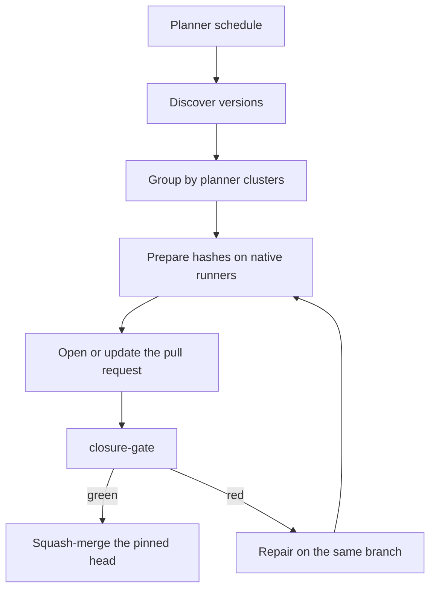

# Update pull requests

The planner opens one pull request for each independent package update. A
shared flake input, a toolchain, or a planner cluster shares one pull request.
An open `update/*` pull request is updated on its branch. The planner does not
open a second pull request for the same branch.

`closure-gate` builds the closures that pull request changes, on the native
runner for each system, and pushes them to `gkze.cachix.org`. This repository
does not compute that closure diff. The gate skips Darwin when no Darwin
closure changed.

Nothing in this path is merged until `closure-gate` and the other required
checks are green. A quarantined candidate is not pushed. Quarantine, a withheld
package, or a broken label is not a repair.

The nightly `Update` workflow remains the full-repo validation. Its schedule
is 07:17 UTC. The planner runs at 09:23 UTC.

## Flow

Discovery uses each updater's `fetch_latest` proof and the flake-ref check.
It does not recompute hashes. Hashing uses the Update prepare stages:
`prepare-pins`, one unsharded Darwin prepare when the group can change a
Darwin hash, both Linux prepares, then `merge-candidates`. A group whose
updaters exclude Darwin skips the Darwin prepare. A moved flake input still
prepares on Darwin.

The publish step refuses a candidate that is not prepared or that records a
quarantine. An empty patch is a no-op and does not push.

## Grouping

- One member is `update/<name>`. A source that shares its flake input
  name is still that one package. It is not `update/group-<name>`.
- A name that collides with `routine-batch` or `group-` uses
  `update/pkg-<name>`.
- A moved input and every source that hashes against it share
  `update/group-<slug>`. Companion and aggregate edges do the same.
- An input that did not move does not pull every package into that group.
- Two or more fresh routine Darwin package bumps share `update/routine-batch`.
  A batch that is already open gains the new member. Linux-only routine bumps
  stay individual. Security and main-fix bumps stay individual. An existing
  individual pull request is not folded into the batch.
- While a batch probe is in progress, new routine Darwin bumps wait. They are
  not opened beside the probe.

The marker `<!-- nixcfg-update-plan ... -->` in the pull request body is the
record the next run reads. It stores the branch, members, heal count, Darwin
bit, and batch probe.

## Queue

Darwin prepare jobs and the heal job use four lanes:
`nixcfg-darwin-main-fix`, `nixcfg-darwin-security`, `nixcfg-darwin-heal`, and
`nixcfg-darwin-routine`. A lane queues. The lanes run at the same time. Four
is the public macOS pool of five, minus one runner. `cancel-in-progress` is
false. `closure-gate` Darwin jobs use the same lane names, taken from the
pull request's priority label.

Priority order is main-fix, then security, then heal, then routine. A routine
repair becomes heal. Security and main-fix stay above heal. The schedule does
not invent a security classification. A manual planner run can pass
`--security` and `--main-fix`.

Every planner, prepare, publish, and merge job pulls and pushes Cachix
(`gkze`). The repair proposal job does not. It holds no Cachix token and no
signing key. The following push job holds those credentials and commits to the
same branch.

`pr-update-prepare` does not run on `update/*`. Those branches already hashed
in this flow. A human packaging pull request still uses the five Darwin
prepare shards.

## Failure

A prepare failure before a pull request exists does not open one. The next
schedule tries again.

When `closure-gate` fails:

1. `healing` or `needs-human` ignores the event.
2. A batch narrows its probe. A probe of one package that fails leaves the
   batch and is opened on its own branch. More than eight probe steps, or an
   empty known-good set, adds `needs-human`.
3. Any other failure asks the existing repair agent for one packaging patch.
   The patch is checked with the Update repair gate, including the quality
   command, then committed and pushed to the same branch. The healer does not
   open a pull request, does not force-push, does not skip a check, and does
   not waive Darwin. The branch is rehashed, and `healing` is removed when
   that rehash finishes so the next gate result can be read.
4. Three heal attempts, or a gate failure with no job log, add `needs-human`.

A green `check_suite` on `update/*` merges only when every check is completed
with success, skipped, or neutral, and a `closure-gate` check succeeded. The
merge command is `gh pr merge <number> --repo <repo> --squash
--match-head-commit <sha>`. A passing narrowed batch probe updates the probe
instead of merging. The first full-batch probe may merge.

A branch that does not start with `update/` is not merged by this workflow.
The nightly Update publication is unchanged apart from its nightly schedule
and the one-day quarantine rot window. That window is one grace publication:
the run that first quarantines a package still publishes, and the next night
fails before certify.

The nightly full validation still spends the closure time recorded in
[free-tier-ceiling.md](free-tier-ceiling.md). Per-package pull requests add
planner and gate time on top of that run.
