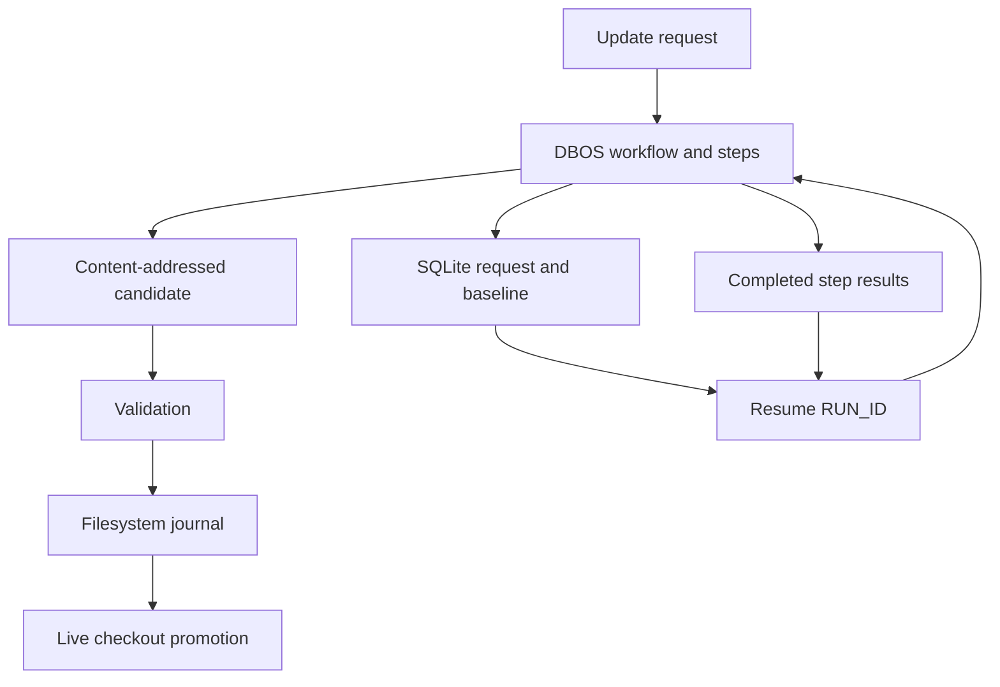

# Update runtime and durable execution

An update prepares one disposable candidate and validates that candidate
before atomic promotion. [safety.md](safety.md) lists the safety invariants
for this boundary. Runtime optimizations keep the boundary, the platform
requirements, the cancellation cleanup, and the per-target failure
ownership. No runtime optimization activates a configuration.

## Durable ownership and recovery

The CLI uses
[DBOS workflows and steps](https://docs.dbos.dev/python/tutorials/workflow-tutorial)
with one SQLite system database for each run. No daemon and no external
database are necessary. DBOS owns the execution identity, the completed
step results, the exceptions, the workflow outcomes, and the restart
recovery. SQLite also stores the original request, the immutable candidate
manifests, the deduplicated file contents, and the diagnostic projections.
This storage replaces the separate JSON status and metadata files and the
JSONL event stream. The plain subprocess log remains for `tail -f`.

The table below maps each older updater concept to its explicit contract.

| Existing updater concept                     | Explicit contract                                                     |
| -------------------------------------------- | --------------------------------------------------------------------- |
| Selected targets and captured dirty checkout | Immutable workflow request and SQLite baseline                        |
| Latest-version discovery                     | Checkpointed resolution step; replay reuses the resolved version      |
| Hashing and artifact generation              | Checkpointed materialization step, including declared artifact bytes  |
| Source dependency graph                      | Independent source workflows with serializable prerequisite results   |
| Ref/input refresh and source persistence     | Steps returning a verified candidate snapshot                         |
| Derivation/root validation                   | Checkpoint keyed by the exact immutable validation snapshot           |
| Live promotion                               | Idempotent filesystem transaction reconciled until the root completes |
| Progress and heartbeat                       | Diagnostic projections; DBOS remains execution authority              |

`nixcfg update --resume RUN_ID` starts DBOS against the database of the
named run. Native recovery resumes the pending root workflows and source
workflows. A completed workflow returns its recorded outcome. A domain
failure stays a completed failure, so a new run is necessary after the
correction. A normal source failure stays inside its promotion cluster and
does not fail an unrelated source workflow.

Recovery restores the original baseline into a new isolated workspace. The
root steps restore the completed ref and input snapshots and the completed
materialization snapshots. A source workflow receives source metadata,
generated artifacts, and effective prerequisite results as serializable
inputs. Source recovery waits until the root restores the resolved inputs
and admits the shared resource environment.

Dynamic updater modules have stable import identities, so the
checkpointed metadata and the typed retry errors can be reconstructed.
Replayed ref outcomes and input-refresh errors rebuild the same terminal
progress state. The original failures remain available in the run
database.

The execution fingerprint covers Python, DBOS, the platform, and the
packaged runtime source policy of the repository. `uv.lock` and dynamic
updater code are part of that policy. A change to the fingerprint rejects
a resume.

Target selection, update policy, and timeouts come from the recorded
request. Only presentation options can change. Each invocation resolves
the terminal layout and the phase headings from the current presentation
options and terminal. That resolution is independent of the checkpointed
update plan. Nix command errors and hash-mismatch errors keep their types,
command results, and notes on replay.

A resumed completed run reports its historical result. It does not repeat
a check of the current upstream state or the live checkout state. A direct
`run_updates` library call stays ephemeral. The `run_update_command`
function of the CLI owns the durable service lifecycle.

A completed step is skipped. An interrupted step can run again, so network
reads, Nix builds, and generators must tolerate repetition. Generated
artifacts must return through the artifact contract. SQLite cannot commit
Git worktree files atomically.

The existing descriptor-based filesystem journal therefore remains the
promotion authority. That authority covers rollback, interference
detection, and post-commit cleanup. If promotion commits before DBOS
records the root completion, replay accepts only the exact complete
promoted candidate. A later external edit blocks promotion.

Candidate snapshots are content-addressed and verified before restoration.
The run directory is private and holds repository bytes and
Python-serialized execution state. That directory is local trusted state,
not an import format for a remote worker.

Recovery requires that the database of the run stays on durable local
storage. The removal of a run retires its execution history. The
[Actions integration](ci.md) instead uses disposable native jobs and
immutable JSON and Git candidates. It shares the updater logic and the
validation logic with local execution. A SQLite history never crosses a
machine boundary.

`--run-id ID` starts or resumes one named history under an exclusive run
lock. A repeated invocation must supply the same execution options.
`--resume ID` instead loads those options, and the invocation does not
restate them. Both forms keep the original configuration and reject
repository drift, platform drift, or runtime drift.

`--patch PATH` exports the exact successful candidate from the DBOS
result, with additions, deletions, and binary changes. A failed run
exports an empty patch. The export is repeatable after a crash and does
not include a later checkout edit.

The deliberate retained mechanics are the dependency and promotion
policy, the exact validation, the resource limits, the subprocess cleanup,
and the filesystem commit recovery. A replacement of those mechanics with
generic workflow status would erase domain invariants. SQLite was chosen
over a shared Postgres service for the single CLI owner and the per-run
lifetime. That deployment choice must change before a database share
across hosts.

## Generation snapshot file recovery

`nixcfg recover files --apply` and `nixcfg recover hashes --apply` perform
planned writes and then removals in plan order. A multi-path recovery is
not atomic and does not roll back completed changes after a failure. The
`RecoveryApplyError` preserves the original exception as its cause and
retains the completed write and removal paths. Plain errors report the
number of completed changes. JSON errors add `completed_paths`,
`completed_write_paths`, `completed_remove_paths`, and `stage_state`.

`--stage` starts only after all planned filesystem operations complete.
`stage_state` is `not_requested` when staging was not requested, `pending`
when a filesystem failure prevented the staging attempt, or `failed` when
`git add` was attempted but did not complete. After a staging failure, the
completed filesystem changes remain and Git may contain a partially staged
subset; inspect `git status` before retrying or changing the index.

## Admission and scheduling

An updater can declare `bulk_update_hold` with a reason. That declaration
keeps the source and the generated artifacts of the updater out of an
untargeted `nixcfg update` run, and out of `--check`. Coupled companion
sources and aggregate sources are held together. An untargeted flake-ref
refresh also skips the flake inputs that back the whole hold closure, so
an overlay that asserts input identity stays coherent. An explicit target
selection still allows updates.

Unsloth participates in bulk updates after desktop `v0.1.909-beta` and
backend `2026.10.7` passed matched-source, native build, and contained
runtime validation. Its updater still requires exact source provenance,
closure hashes, and fresh runtime evidence before exporting a candidate.

Goose CLI and desktop 1.55.0 participate in bulk updates after matching
native CLI and desktop validation, plus signed-cache verification of the
exact `goose-cli-v8-native` output for the current package configuration.
That proof must track the required V8 derivation, including its compiler,
GN, and stdenv inputs, whenever the package configuration changes.

Run 36672202468 failed Darwin closure builds that a later shard still had
to rebuild. Those pins stay in the closure, and the build correction is
in tree. Comet rematerializes the mutable `comet_latest.dmg` hashes on
Darwin prepare; Linux ARM reuses those hashes instead of prefetching R2.

The app executable of Superconductor is `super.engineering`. The
`CFBundleExecutable` of Reason is `Reason`. OpenCode 1.18 ships
`packages/cli/package.json` without the Effect updater service, so
OpenChamber keeps the 1.x upgrade patch.

Baseten Switch 0.7.2 participates in bulk updates after native Darwin Go
and Swift validation passed. The earlier 0.6.0 hold followed headless
macos-15 Swift SIGTRAP failures. The package keeps its historical 0.5.1
check-phase exception and named headless-test skips; those exceptions do
not place the current release on hold.

Hosted Darwin validation builds native `root-closures` in continuation
shards. Run 36672202468 showed why one job cannot do that work. After a
~17-minute fetch burst, the tail started about six derivations a minute.
Thousands of derivations were still queued when the 360-minute cap
cancelled the job. Package validation had already used the first half of
that same job. A store GC between the two phases deleted outputs that the
closure then had to rebuild.

Shards keep package validation off that budget. Each closure shard builds
for five hours without `-L` and flushes the Cachix daemon. The next shard
substitutes what landed in `gkze`. A store unlink or a SIGBUS on those
runners is retried with only the time left in the shard budget. The run
then hands that work to the next shard in the same way. The last shard
still fails closed.

A derivation failure reported by current Nix (`error: Cannot build` or a
failed dependency) is not treated as that fault. `min-free` / `max-free`
stay at 32 / 64 GiB, and `max-jobs` / `cores` stay at 2. The hosted runner
already kept both build slots busy on that tail.

Each update invocation owns its concurrency limits, its shared work, and
its timings. No process-global build semaphore is tied to a previous event
loop.

| Environment variable          | Default | Controls                                 |
| ----------------------------- | ------: | ---------------------------------------- |
| `UPDATE_MAX_SOURCE_TASKS`     |       8 | Active source updater tasks              |
| `UPDATE_MAX_NIX_EVALUATIONS`  |       4 | Concurrent Nix evaluation processes      |
| `UPDATE_MAX_NIX_BUILDS`       |       1 | Concurrent Nix build/run/shell processes |
| `UPDATE_MAX_DOWNLOADS`        |       8 | HTTP requests and URL prefetch processes |
| `UPDATE_MAX_MATERIALIZATIONS` |       1 | Active crate2nix materialization workers |

`--max-nix-builds` overrides the build environment setting. A Python
caller can set each limit through `resolve_config`. A zero limit and a
negative limit clamp to one. These limits control updater processes. The
Nix daemon job settings, the core settings, and the remote builder
capacity still control the work inside each process.

All selected flake input refreshes finish before concurrent source
evaluation starts. Every selected input resolves in one
`nix flake update` batch, so N lock evaluations become one. A source waits
only for its declared prerequisites. The completed source and artifact
results become visible before a dependent task starts. A failed
prerequisite prevents dependent work, and an independent source continues.
A wait for a prerequisite does not consume a source-task slot.

Dependency edges come from `companion_of` and `aggregate_into`. The
workspace `sources.json` files keep their pre-update entries during a run.
A companion therefore evaluates its hash probes against its parent's
result from the run, not against the parent's workspace file.
The `graphlib.TopologicalSorter` of Python owns the cycle detection and the
prerequisite ordering. The planner translates a cycle error into an
updater diagnostic. The planner creates the tasks in that order, so a
prerequisite exists even with an eager task factory.

Each task awaits its own prerequisites inside an `asyncio.TaskGroup`. The
order does not impose execution waves. Dependency depths remain only for
target ordering. The runtime removed the obsolete wave scheduling.

A workspace read/write gate protects temporary generated files. Ordinary
readers can overlap. A temporary artifact writer excludes an unrelated
reader through generation, consumption, and restoration. The owning task
prepares a fixed-output probe before a child build starts. Those builds
use immutable store derivations and do not need access to the mutable
workspace.

A crate2nix worker reads the workspace under this gate and generates
outputs in scratch directories. Each subprocess of a worker acquires the
same Nix resource limits as an async command. The calling task joins a
cancelled worker before that task releases its workspace access. The
shared Cargo cache lock covers actual generation attempts and is released
during retry backoff.

The source phase joins shared producers before its HTTP session and
disposable workspace close. The outer runtime keeps a fallback join for
standalone helpers. These boundaries protect different lifetimes. Event
delivery and crate2nix worker teardown use the same cancellation-safe
completion helper. The owners cancel or signal the work, shield its
cleanup from additional stop requests, and propagate the cancellation
after it finishes. A shared producer failure stays local to its consumers
and does not abort an unrelated update.

The workspace gate and the thread admission bridge remain local, because
they own updater-specific invariants. Temporary artifacts stay hidden
until restoration, and synchronous crate2nix commands share the async Nix
budgets. Reader ownership is the single authority for the active-reader
count. A new workflow engine or an AnyIO migration would not remove these
requirements. The current runtime uses standard-library graph, task,
semaphore, and condition primitives.

## Probe preparation and reuse

`PreparedProbe` retains the exact isolated derivation path, the full path
and fingerprint of the original fake-hash derivation, and the probe
expression. A platform matrix is evaluated in one JSON command with a
shared native nixpkgs binding for probe isolation. Platform package
evaluation contexts remain distinct. The build uses `drvPath^out`. A retry
reuses that path and does not evaluate the expression again.

The hash parser associates each hash with its own mismatch block. A
prepared probe accepts a mismatch that names either its prepared wrapper or
the original fingerprint derivation. The latter is the supported nested
fixed-output mismatch produced while Nix builds the original expression.
A mismatch from any other nested derivation cannot certify the probe.

A shared hash strategy targets its fixed-output dependency directly:
`goModules`, `cargoDeps`, `npmDeps`, or `node_modules`. A custom
pnpm/offline-cache path remains explicit. OpenCode Desktop probes
`node_modules`. The T3 workspace uses the same prepared-probe contract
instead of repeated fingerprint stabilization evaluations.

`sources.json` can now include `platformDrvHashes`. A requested platform
hash is reused only with a matching certificate. A changed platform is
probed again. Legacy entries remain readable.

When hashing is necessary, a platform without a certificate is reprobed. A
native-only update keeps a foreign certificate only when the associated
values remain valid. Final package validation and root validation still
run. A certificate reuse does not bypass those checks.

Node candidate discovery evaluates the available versions in one command.
Each candidate is forced under `tryEval`, so a missing candidate or a
broken candidate does not invalidate the entire inventory. The selection
still chooses the lowest compatible version. A whole-package inventory is
not memoized against a mutable checkout. Locked source realization is
shared within a run through the immutable locked node expression. Each
caller validates the returned path.

## Warmup plan provenance

A generated `WarmupPlan` records the exact candidate `tree` alongside its
output and derivation sets. Native validation passes that same candidate tree
to every warmup realization. The Zed-only workflow restores plans by branch,
but accepts one only when its tree exactly equals the checked-out `HEAD` tree;
a default-branch fallback is not an exception. Unbound legacy plans remain
readable by inspection helpers only and cannot cross a realization boundary.
A mismatch fails closed so the caller can regenerate the plan instead of
realizing stale store paths while reporting a current candidate.

## Generated artifacts and downloads

The audited crate2nix targets use optional receipts under
`$XDG_CACHE_HOME/nixcfg/generation-receipts`. The normal user cache
fallback applies. A receipt binds the realized patched store source, the
target options, the platform, and the full flake lock. A receipt also binds
the generator and normalizer implementation, the relevant tool and
environment identities, and every current output digest.

A missing receipt, a changed receipt, a malformed receipt, or an
unreadable receipt regenerates normally. Only digests and output names are
persisted. Raw environment values and credentials are not stored. The
patched source is still resolved before a receipt can authorize reuse.

T3 Desktop and the T3 CLI share one runtime-lock generation within a run.
That generation is keyed by the resolved generator derivation and its
workspace runtime inputs. The producer returns immutable artifact contents
and restores its temporary files. Each consumer then installs and restores
those contents under the workspace gate.

A cancelled consumer cannot cancel the work that another consumer needs.
A failed producer is removed from the run cache. A cache entry does not
outlive the run. The two lock refreshes share one disposable Bun download
cache.

A repeated Bun tarball URL shares downloaded bytes within the same
attempt. Deno metadata requests share in-flight work per manifest. URL
source hashing uses `nix store prefetch-file --json`. That command returns
SRI directly and removes the separate hash-conversion process. An HTTP
retry and a prefetch retry release admission slots before the wait.

A mutable registry response is not persisted across update runs. That rule
prevents a change to latest-version resolution. It also prevents the
treatment of an unauthenticated URL as an immutable content identity.

## Validation and observability

Successful validation keeps the existing grouping. A batched build passes
`--keep-going`, so one Nix invocation builds everything that can build and
reports every failing derivation. A later isolation round mostly hits the
store. A failed group is split in half to isolate a sparse failure. A
small group uses individual checks with the original retry policy. When
both halves fail, the subdivision stops and individual diagnostics cover
the whole group.

That behavior bounds the extra work for a systemic failure. It keeps every
required target and the root-closure build gate.

A validation failure does not discard the run. A failing target is
withheld with its coupled targets (see [README.md](README.md)). The
smaller candidate is validated again. Root closures build once on the
candidate that will be promoted. The rounds are bounded at three. A
candidate that still fails after that is discarded as a whole.

The declared paths of a failed target return to the captured baseline
before the next round. Every written path without an owner in a
still-promoted target returns there as well.

One run monitor owns the progress state, and the asynchronous phases and
the synchronous validation phases share it. A producer records an event
from any thread. The live panel, the plain-output heartbeat, and `--status`
all read snapshots of the monitor. SQLite stores the structured events and
the heartbeat snapshot. `output.log` contains subprocess lines and remains
line-buffered.

Both diagnostic paths apply the same URL redaction as the terminal output.
A failure inside an updater task stays in that target, and the traceback
is stored in the `detail` field of the error event. `--status` reads the
DBOS status and does not start a worker or deserialize a workflow input or
result. The heartbeat age and the execution status remain distinct.

`--timings` reports per-source operation counts, active time, admission
wait, cache hits, failures and cancellations, and captured byte counts.
The `--timings` option with `--json` produces a machine-readable `timings`
array. The run owns the timing collection, and the reporting is opt-in. A
row contains an operation label rather than a command, a URL, an
environment value, or a cache key.

Rows are nested and can overlap, so a sum does not give the wall time. The
source elapsed time includes nested operations. The `dependencies` field
records the wait for a prerequisite. The `wait_seconds` field records
resource admission and workspace admission. A nonzero exit is separate
from an exception, because an expected FOD mismatch is a successful
hash-probing outcome. An output byte field describes retained command
output.

The subprocess line queue is bounded at 128 items, and the update event
queue is bounded at 512 items. A consumer failure wakes the blocked
producers and joins both sides. A diagnostic-only generator keeps a
bounded output tail. A JSON parser and a hash parser keep the complete
output. A plain log line bypasses the ANSI parsing.

The input declaration cache and the lock-graph cache are bounded and keyed
by exact input bytes. Snapshot instrumentation records bytes and time. It
uses one content read and one stat-fingerprint race check instead of a
second content read.

## Validation evidence and remaining costs

The runtime optimization measurements are these:

- A tiny local fixed-output fixture completed with exactly one
  `nix eval` and one `nix build`. Its SHA-256 matched the digest that
  Python computed independently. The two commands took 1.363 seconds on
  the development host with substitutes disabled. This result is a
  protocol acceptance check, not a package benchmark.
- A real Gogcli `goModules` probe and a real Hwatch `cargoDeps` probe
  prepared successfully in a single evaluation with import-from-derivation
  disabled. No build ran.
- For 21 distinct backing inputs in the inspected source inventory, the
  old receipt function took 115.7–128.9 ms per pass. The new first pass
  took 13.6 ms. A repeated call on the same bytes took 0.0016–0.0026 ms.
  All receipts matched. These figures exclude filesystem reads and network
  or build work.
- Tests cover a 26-target validation group with one failure. That group
  uses at most 11 commands, against the previous 27-command full fallback.
  If all 26 targets fail, the new path uses 29 commands, and its two
  subdivision checks are part of that count.

A first-run crate2nix generation can still hold workspace read access while
Cargo works, and that hold delays a temporary artifact writer. A
cross-source package context is not combined speculatively, because the
candidate overrides and the dependencies can differ. A real builder, a
download, and the required root-closure validation can still dominate the
total runtime. No full-update percentage speedup is claimed.

## Related

- [safety.md](safety.md): the executable safety invariants for `nixcfg update`.
- [ci.md](ci.md): the hosted `Update` workflow and its disposable native
  builders.
- [source-modifications.md](../source-modifications.md): the policy for a
  change to an upstream source tree.
- [README.md](../../README.md): the repository overview and the update
  entry points.
- [AGENTS.md](../../AGENTS.md): the repository rules for agents and
  contributors.
- [DBOS workflows and steps](https://docs.dbos.dev/python/tutorials/workflow-tutorial):
  the durable-execution model behind the run database.
- [Nix manual](https://nix.dev/manual/nix/latest/): the Nix language and
  command reference for the derivation and store behavior below the file
  boundary.
