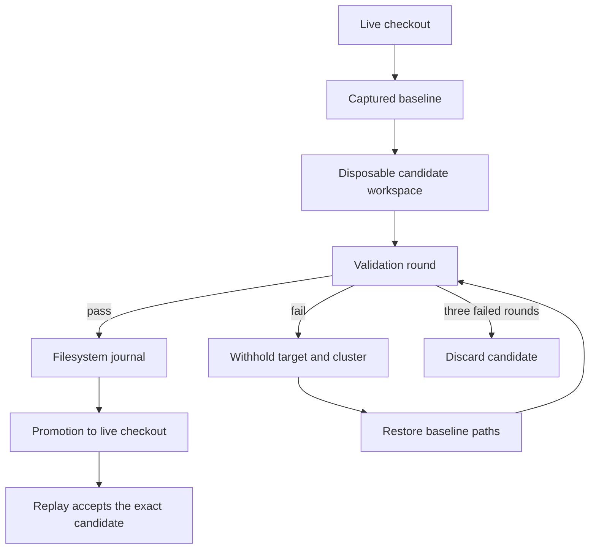

# Update safety invariants

This document is the executable safety argument for `nixcfg update`. Each
invariant names the code that owns it and the test that pins it. A reviewer
of the update runtime checks a change against this list instead of a
reconstruction of the safety argument from scattered modules. An author of
a change that weakens one of these invariants must call that weakness out
explicitly.

The pipeline shape is this. Python owns the update graph (feeds, reviews,
and file rewrites). DBOS owns the workflow and step recovery. SQLite
retains the immutable baselines and the candidate contents. Nix owns the
build graph below the file boundary. The UI is a pure consumer of run
events.

## Candidate isolation and write authority (1–7)

1. **One writer per repository.** A process-global lock and a repo-level
   file lock admit exactly one update workspace for each checkout. A
   concurrent run fails fast instead of an interleave.
   (`persistence.IsolatedUpdateWorkspace`)
1. **The live checkout is immutable during a run.** All updater work occurs
   in a disposable candidate tree. The live checkout changes only at
   promotion. (`persistence.IsolatedUpdateWorkspace`)
1. **Write authority is predeclared.** Every persisted path must belong to
   the planner-declared upper bound. An unexpected write aborts the
   transaction before promotion. (`cli._workspace_allowed_paths`)
1. **Snapshots are stable or rejected.** A source view is read once and
   verified by a stat-fingerprint second pass. `st_ctime_ns` changes on any
   write or metadata change, and `st_ino` changes on a replacement. A
   moving working tree fails the run instead of a validation of a mixed
   state. (`persistence._snapshot_source_view`,
   `lib/tests/test_update_persistence_transactions.py`)
1. **Symlinks cannot escape.** A repository-relative symlink target must
   resolve inside the repository, in the workspace and in any snapshot.
   (`persistence._validate_workspace_symlink`)
1. **Baseline restore precedes re-validation.** The declared paths of a
   withheld target return to the captured baseline before the next
   validation round. Every written path without an owner in a
   still-promoted target returns there as well.
   (`persistence.IsolatedUpdateWorkspace.validation_snapshot`)
1. **Promotion is the only live-checkout commit, and it is journaled.**
   SQLite checkpoints the candidate bytes, and DBOS checkpoints the
   execution results. The filesystem journal guards the separate promotion
   crash window. A replay after a committed promotion accepts only the
   exact full candidate and preserves an external edit in every other case.
   The scratch tree is disposable. (`persistence`, `durable`,
   `lib/tests/test_update_durable.py`)

## Validation gating (8–12)

1. **A candidate is never promoted unvalidated.** The derivations that the
   selected updaters declare evaluate on all declared systems. Root
   closures build on the exact candidate that would be promoted, for every
   configured system, when any path changes. Cached validation is keyed by
   the exact source view materialized for that validation, not by a prior
   mutable tree or a later mutable tree. (`derivation_validation`,
   `cli._validate_round`, `cli._requires_root_closure_validation`)
1. **Failure attribution is bounded, not silent.** A batched validation
   passes `--keep-going`. A failed batch is bisected, and the subdivision
   stops when both halves fail, so a systemic failure adds at most two
   attempts for each boundary. Eval-mode bisection is necessary, because
   the evaluator cannot attribute a per-request failure inside one batched
   eval. A missing-attribute error escapes `builtins.tryEval`. That
   evaluator property is pinned by `lib/tests/test_update_tryeval_contract.py`.
   If the property changes, the attribution can move into a single command.
1. **Withholding is coupled, not per-target.** A failing target withholds
   its dependency cluster, so a partial candidate is never promoted. The
   rounds are bounded at three. Strict mode keeps the whole run atomic.
   (`cli._withhold_failed_clusters`, `cli._validate_and_gate`)
1. **Evaluations disable import-from-derivation.** Every candidate evaluation
   therefore cannot execute downstream build code during probing, including
   root manifests, shard planning, coverage out paths, and realized-root
   receipts. The dependency-free `nix_policy.NO_IMPORT_FROM_DERIVATION_ARGS`
   tuple is shared by derivation validation, prepared probes, fingerprints,
   crate2nix generators, source discovery, shard planning, coverage, and CI.
1. **Batch keys stay conservative.** Only explicit local attribute paths
   from one immutable snapshot batch together. Any other path validates
   individually. (`derivation_validation._batch_key`)

## Lock and receipt consistency (13–15)

1. **flake.lock writes are serialized and receipt-scoped.** A ref task
   serializes the flake edits and the receipt capture under one edit lock.
   A source task reuses a refresh only when the recorded receipt still
   equals the current declarations and the reachable lock graph. An unknown
   fetcher field, dynamic Nix, or unfamiliar lock semantics degrades to
   exact-file identity instead of a narrower receipt.
   (`refs.update_refs_task`, `input_state.flake_input_state`)
1. **A failed ref task publishes no receipt.** A receipt comes only from a
   task that completed a verified refresh or a remote check. The "updated"
   outcome and the "no-change" outcome both record a receipt. An error
   never records one. (`source_runner.run_ref_phase`,
   `lib/tests/test_update_input_refresh.py::test_ref_result_failure_never_publishes_a_refresh_receipt`)
1. **Input refreshes finish before any source task starts.** All selected
   inputs resolve in one lock update. A failed resolution fails every
   source with a pending input in its closure, and an independent source
   continues. (`source_runner._refresh_source_inputs`)

## Process boundaries (16–19)

1. **Failures are confined to their target.** An updater failure of any
   exception class becomes the error event of that target. Cancellation is
   the only exception that propagates. The cleanup of a cancellation is
   shielded from further stop requests. (`process.run_queue_task`,
   `runtime.await_cleanup`)
1. **Shared producers cannot outlive their consumers' workspace.** The
   source phase joins the memoized producers before the session and the
   disposable workspace close. A failed producer is never retained for
   reuse. (`runtime.memoize`, `runtime.join_shared_work`)
1. **Diagnostics are redacted at every boundary.** The terminal output, the
   run logs, and the event payloads pass the same URL redaction. A timing
   carries an operation label and never a command, a URL, or a cache key.
   (`diagnostics.redact_urls`, `runtime.OperationTiming`)
1. **Generation receipts bind their environment.** A crate2nix receipt
   reuse requires a match of the realized source, the target options, the
   platform, and the lock. The generator identity, the tool identity, and
   all output digests must also match. Only digests are persisted.
   (`generated_artifact_commands`, `generation_receipts`)

## Disposable builders and repair (20–23)

1. **Preparation cannot authorize publication.** A native stage can
   temporarily carry an incomplete platform hash. The stages extend one
   pinned candidate serially. Validation requires every configured
   preparation platform and checks the exact final tree. Certification
   requires one successful report from every native builder, without a
   duplicate identity and without a mismatched identity.
   (`candidate.Preparation`, `ci.candidate`, `lib/tests/test_update_candidate.py`)

1. **Quality checks cannot inherit evidence after a candidate change.**
   The publication job verifies the baseline, the applied tree, and the
   post-check tree. Formatter drift and generator drift require a new
   validation attempt. (`ci.jobs.certify`, `lib/tests/test_update_ci.py`)

1. **A publication target must still be the certified baseline.** The
   certified tree is published whole, so publication refuses a default branch
   whose tree no longer matches the tree the candidate was certified against.
   A repair candidate retains its repair checkout as `base_tree`, while the
   publication guard uses the approved repair commit's parent tree as the
   original main baseline. Its follow-up keeps the approved repair branch as PR
   head for both no-op and changed results. Publishing onto any moved base would
   silently revert commits that landed after certification, including
   hand-authored patches that no updater owns.
   (`ci.jobs._commit_and_push`, `ci.jobs.publish`,
   `lib/tests/test_update_ci.py`)

1. **Repair is bounded and has no validation authority.** One isolated
   agent proposal can change packaging, flake references, and
   planner/selection coherence. A repaired attempt starts a fresh
   execution, passes the existing quality gates and builds, and cannot
   repair itself again. The CI agent job holds only read tokens; a separate
   `update-repair-approval` environment job applies its patch, signs, pushes,
   and dispatches only after a trusted reviewer approves the exact artifact.
   The receipt binds its patch digest and tree, and the follow-up pins every
   checkout to the approved `repair_commit`. The environment's required-reviewer
   protection is configured in GitHub settings, not by repository YAML. Before promotion,
   a structural check rejects a check skip (`doCheck`, `dontCheck`, or a
   `checkFlags` `--skip`) unless its whole binding has the correct polarity at
   one package-owned literal failing version and an adjacent comment. It also
   rejects a new `bulk_update_hold`. Whether the failing tests are upstream's
   own, not George's code, stays a review judgment. A local repair keeps the
   same atomic promotion boundary.

   After an agent proposal, the local retry and the CI candidate both
   validate the complete registered updater declaration inventory. That
   validation is independent of update targets and bulk holds, and it also
   occurs when the retry has no update changes. A failed declaration blocks
   acceptance and cannot be withheld to accept a partial repair. The shared
   derivation validator supplies this inventory, which preserves the
   platform guards without a map from a changed file to a package owner.
   The existing root gate and quality gates still apply. A package without a
   validation declaration gains no new coverage from this rule.

   Locally the fresh retry owns both package validation and root
   validation, even when the repaired bytes are already its baseline. The
   supervisor freezes that result around the quality hooks and rejects a
   mutation before promotion. It does not repeat the root builds. A
   metadata-only `--validate` cannot be combined with repair. (`repair`,
   `ci.jobs.start_repair`, `lib/tests/test_update_repair.py`)

## Related

- [runtime.md](runtime.md): the durable-execution runtime that keeps these
  invariants.
- [ci.md](ci.md): the hosted `Update` workflow, candidate isolation, and
  the repair boundary.
- [source-modifications.md](../source-modifications.md): the policy for a
  change to an upstream source tree.
- [README.md](../../README.md): the repository overview and the update
  entry points.
- [AGENTS.md](../../AGENTS.md): the repository rules for agents and
  contributors.
- [Nix manual](https://nix.dev/manual/nix/latest/): the Nix language and
  command reference for the build graph below the file boundary.
- [DBOS workflows and steps](https://docs.dbos.dev/python/tutorials/workflow-tutorial):
  the durable-execution model behind the workflow and step recovery.
