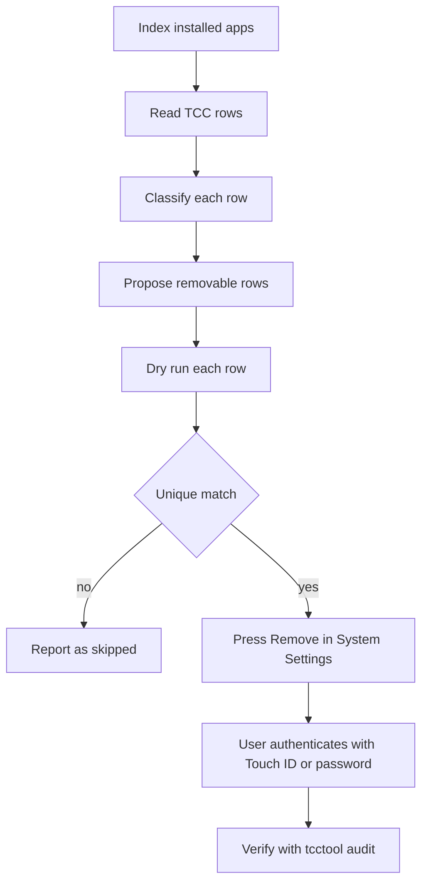

# TCC / Privacy List Audit

`tcctool` is the entire operational surface of this skill. It reads the system
TCC database and drives the System Settings panes through the native
Accessibility API. There are no shell scripts to run, and no manual reads of
the screen. Every action below is a `tcctool` invocation.

Read-only by default. `tcctool audit` classifies every entry and prints the
stale ones. `tcctool clean` and `tcctool remove` propose and perform removals
one row at a time. The first deliverable of any audit is the table plus a
removal proposal. `tcctool` removes nothing without explicit approval of
specific rows. macOS still demands the user's own Touch ID/password for each
removal.

## Flow



## Ground rules

- The system TCC database at
  `/Library/Application Support/com.apple.TCC/TCC.db` is the source of truth
  for every System Settings privacy pane. `tcctool` queries it. Never parse
  screens when the DB answers.
- The database is **not writable** while SIP is on, not even as root. Direct
  DB edits require a Recovery OS boot. There is no supported inline bypass.
- The per-user database at `~/Library/Application Support/com.apple.TCC/` is
  not readable. The system database covers the panes that matter.
- Auth values: `2` = allowed, `0` = denied/never. `client_type` 0 = bundle id,
  1 = full executable path.
- A row removal needs System Settings (select row, click Remove) plus the
  user's own Touch ID/password. `tccutil reset <Service> <bundle-id>` works
  only for apps that LaunchServices still knows, and only for bundle-id rows.
  For uninstalled apps it fails with `-10814`. It can never clear a path row
  (`/nix/store/...` churn). That is why removal goes through the panes.

## Command surface

```sh
tcctool audit                     # stale rows only: the default deliverable
tcctool audit --all               # also live, system, and unrecognized rows
tcctool audit --json              # {"rows": [...], "actionable": N}

tcctool clean --dry-run           # select + verify every actionable row, no clicks
tcctool clean                     # press Remove per row (Touch ID per row)
tcctool clean --json              # {"results": [...], "failed": N, "skipped": N}

tcctool remove <pane> <row-text> --dry-run   # prove one row matches uniquely
tcctool remove <pane> <row-text>             # select + Remove that one row
```

`<pane>` is one of `Privacy_AllFiles`, `Privacy_Accessibility`,
`Privacy_ScreenCapture`, `Privacy_ListenEvent`, `Privacy_PostEvent`,
`Privacy_DeveloperTool`. `<row-text>` is the row's exact display name.

Exit codes: `0` when the command did what was asked. This result covers a dry
run that selected every row and a run with nothing to do. `1` when a requested
removal did not complete. `2` when the TCC database cannot be read.

`clean` exits `1` whenever any actionable row was left undone, so a partial run
never reads as success. `clean --json` carries the same classification per row.
`handled` is `true` for `Selection` (dry run) and `Removed`. `failed` counts the
rows that were not handled.

`audit` statuses and their meanings:

| status            | meaning                                                                                                              |
| ----------------- | -------------------------------------------------------------------------------------------------------------------- |
| `dead-path`       | path client whose target no longer exists (nix-store churn, uninstalled binaries)                                    |
| `hidden-orphan`   | bundle id that no installed app carries and LaunchServices does not register. The pane hides the row and it is inert |
| `name-ambiguous`  | two or more rows share this display name, so a dead one cannot be targeted safely                                    |
| `policy-kept`     | company-managed or known-keep identity. `tcctool` never proposes this row for removal                                |
| `unrecognized`    | a service or client shape this model does not interpret yet (usually a new macOS service)                            |
| `live` / `system` | still valid / Apple-owned (only shown with `--all`)                                                                  |

`clean` reports one outcome per row: `Selection` (dry run), `Removed`,
`StillPresent`, `WrongPane`, `NotFound`, `Refused`, `SelectFailed`,
`RemoveButtonMissing`, `PressFailed`. A press the user has not authenticated yet
reports `StillPresent`, because `clean` polls the row until it disappears
instead of watching the prompt. Rows that `clean` cannot even reach the
removal path report `failed (System Settings did not start)`,
`failed (System Settings not addressable via AX)`, or
`skipped (no pane mapping)`. All three count as not handled and exit non-zero.

## Audit pipeline (what `tcctool audit` does)

1. Index installed apps: scan each app root
   (`/Applications`, `~/Applications`, `~/Applications/Home Manager Apps`,
   `/System/Applications`) plus configured extra globs for `Info.plist`.
   Extract `CFBundleIdentifier` and `CFBundleName`.
1. Read every row of the system TCC.db (`service`, `client_type`, `auth_value`,
   `client`). Keep unrecognized shapes observable. Do not drop them.
1. Classify each row against the bundle index, LaunchServices, and the policy
   keep-list.

Two exactness rules apply when you judge the output:

- **`tcctool` matches bundle ids exactly.** LaunchServices registration comes
  from the `identifier:` records of `lsregister -dump`. `tcctool` matches whole
  identifiers, never a substring. Never use Spotlight for this check, because
  `mdfind` flips between runs and must not decide staleness. A substring test
  would call an unregistered id live whenever it prefixes a registered one, and
  hide a dead row.
- **`tcctool` decides path rows by existence only.** No name heuristics.

## Identity rules (read before you judge anything stale)

- **Match by bundle id, never display name.** Apps on this machine change name
  routinely while they keep old bundle ids. Recorded rebrands (update as
  discovered):
  - `~/Applications/ChatGPT.app` → `com.openai.codex`
  - `/Applications/Muse.app` → `com.meta.endo`
  - `/Applications/Grok Bot.app` → `com.anysphere.sand`
  - `/Applications/CuaDriver.app` → `com.trycua.driver`
  - `Twilight.app` → `app.zen-browser.zen`
- The same display name can have both a dead and a live row. Two `claude`, two
  `dust`, four `nix`, two `Discord`, and two `ChatGPT` rows have all appeared.
  `tcctool` refuses such rows as `name-ambiguous` and does not guess. Do not
  hand-pick one by eye.
- nix/store path rows (`bash`, `coreutils`, `nix`, `dust`, `claude`,
  `python3.14`, `dark-mode-notify`) accumulate on every rebuild, because TCC
  keys path clients by full store hash. Old hashes die and the rows stay. These
  rows are the main `dead-path` set.
- The screen-capture pane's bundle rows display the app name **from grant
  time**. A renamed app can keep its historical label. For example, a row that
  reads "Codex Computer Use" may be the current ChatGPT.app.

## Removable rows and inert rows

- **Pane-removable:** rows System Settings lists and that `tcctool` reports as
  `dead-path`. Removal = select row + Remove button + user's Touch ID.
- **Inert orphans:** rows for unregistered bundle ids are hidden from panes and
  rejected by `tccutil`. They are dormant, because a grant to a nonexistent
  binary cannot be exercised unless the same signed binary returns. `tcctool`
  lists them as `hidden-orphan` and never proposes them. Do not chase them.
  Note them.
- A full purge of inert orphans needs Recovery OS DB surgery. That work is not
  worth a maintenance session.
- **Never** create stub apps, and never impersonate a real vendor's bundle id,
  to make `tccutil` or LaunchServices unlock rows. That action is
  security-control tampering. That approach was rejected before. It stays
  rejected.
- The policy keep-list in `lib/macos/tcc_audit/audit.py` protects
  company-managed identities (MDM/EDR agents and similar). That list is the
  authority. Do not restate it here and do not work around it. If a kept row
  genuinely must go, change the policy deliberately and say why.

## Removal mechanics (what `clean` and `remove` do)

Both commands go through the
[Accessibility API](https://developer.apple.com/documentation/applicationservices/axuielement).
They open the pane and confirm that System Settings shows **that** pane. They
find the row by its static text, require a unique match, select it, and press
Remove. A dry run proves a unique match and selects the row. **Always dry-run
first when the name is not obviously unique.**

macOS then raises the Touch ID/password prompt. That prompt belongs to a
separate trusted process, and `tcctool` never automates it. The caller
authenticates and then verifies with `tcctool audit`, not with the UI.

The pane check is part of the removal invariant, not a nicety. The pane open
only proves that NSWorkspace accepted the deep-link URL. The AX row walk spans
the whole application, not the visible pane.

`tcctool` waits (bounded) for the pane's AX title to match the requested pane.
It fails closed with `WrongPane` when the title does not match, and names the
pane it asked for and the title it saw. A `WrongPane` result means `tcctool`
selected nothing and pressed nothing.

The AX path is environment-gated. A freshly launched System Settings may not
expose its AX tree at all. Assistive access is also subject to the managed TCC
policy profile (see Dependency notes). Treat audit output as the source of
truth. Cleanup is opportunistic and works best just after an interaction with
the target pane.

## Dependency notes

`tcctool` is a Python CLI shipped by this repo's `nixcfg` package on Darwin
(`bin/tcctool` beside `bin/nixcfg`). Inside the repo dev shell,
`uv run tcctool` runs the same entry point. It runs with
the same interpreter and pinned dependency set as `nixcfg`, so there is no
ad-hoc `pip install` and no shell-script layer. Its only native dependency is
[PyObjC](https://pyobjc.readthedocs.io/) (`pyobjc-core`, `-Cocoa`,
`-ApplicationServices`), declared in `pyproject.toml` and pinned in `uv.lock`.
The Nix build supplies it.

A read of the database also requires the terminal that invokes `tcctool` to
hold **Full Disk Access**. The file looks world-readable, but SIP gates the
open. When the database cannot be read, `tcctool` exits non-zero with a
classified message rather than a traceback. Read that line before you assume
the database is corrupt.

## Permission-failure debugging (EPERM)

When an app reports that it "couldn't read" another app's data (cookie imports,
browser automation that reads a browser profile):

1. Check the logs of the app that failed for `EPERM`. Apps map TCC denials to
   generic messages for the user, so the log is the source of truth. For
   example, `~/Library/Logs/Claude/main.log`,
   `[ChromeImport] site index read failed { error_code: 'EPERM' }`.
1. Confirm the target data exists and is fresh (which Chrome profile, which
   cookie db path). A stale or abandoned profile that fails to enumerate is a
   separate bug from access.
1. Grant the app that reads the data the relevant TCC service (usually Full
   Disk Access) via the pane. Then fully restart the app. Grants apply to new
   file reads, but apps cache earlier failures and UI state.
1. Verify grants in the TCC database (`auth_value = 2`), not the toggle UI. UI
   state can change before authentication completes.

## AX implementation notes (why the removal path is shaped this way)

These notes are internals of `lib/macos/tcc_audit/accessibility.py` and
`removal.py`, not steps to perform. They are recorded so the same dead ends are
not re-explored.

- Pixel clicks fail to select rows. Selection goes through the `AXSelected`
  attribute.
- The Remove button only enters the AX tree after a row becomes selected. The
  generic `AXButton` title match must be unambiguous.
- Screen-recording panes carry a second, audio-only list. A row match spans
  every outline and must be unique.
- Secure prompts are invisible to the AX tree. `screencapture -x -o -l<id>`
  plus vision is the only way to read one. Automation of that work is not worth
  the effort.
- `description` on an `AXStaticText` returns the generic role string. The row
  name lives in its `AXValue`.

## Related

- [Architecture notes](../../../../docs/architecture.md)
- [Development guide](../../../../docs/development.md)
- [Packaging guide](../../../../docs/packaging.md)
- [Repository README](../../../../README.md)
- [PyObjC documentation](https://pyobjc.readthedocs.io/)
- [Apple Accessibility API reference](https://developer.apple.com/documentation/applicationservices/axuielement)
