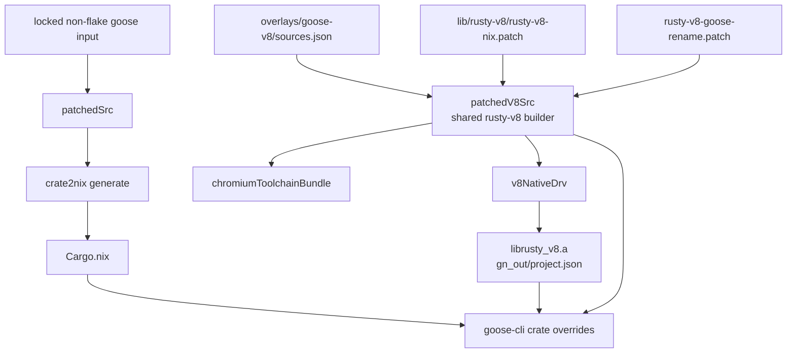

# Goose crate2nix packaging notes

This overlay packages Goose with
[crate2nix](https://github.com/nix-community/crate2nix) to get a cacheable
per-crate Rust build graph. The overlay also keeps the custom V8 setup of
Goose.

## File ownership: generated vs hand-maintained

### Generated

- `Cargo.nix`
  - generated by `crate2nix`
  - checked in on purpose. The build does not generate the file.
  - post-processed for `rootSrc` use instead of an assumption that the
    generated file sits next to the Goose workspace source

### Hand-maintained

- `default.nix`
  - update-time workspace surgery for Goose and V8
  - build-time patches for the individual crates that need them
  - crate overrides and compatibility shims
  - final `goose-cli` package assembly
- `crate-sources.json`
  - crate source pin metadata for the locked Goose input
  - read by `default.nix` through `builtins.fromJSON`
- `sources.json`
  - records the locked `goose` revision and hashes
  - maintained by `updater.py`
- `crate-hashes.json`
  - crate2nix hashes for fetched git crates that are not on crates.io
- `hipstr-no-serde-bytes.patch`
  - transitive crate patch for `hipstr 0.6.0`
- `rusty-v8-goose-rename.patch`
  - extra patch for the V8 source input
  - passed to the shared rusty-v8 builder as `extraPatches`
- `patch_source.py`
  - patches the Goose source tree into the shape that this overlay expects
  - uses the exact-count helpers in `lib.codemods`
- `normalize_cargo_nix.py`
  - pure package-specific callback that post-processes a freshly generated
    `Cargo.nix`
  - adds `rootSrc` and rewrites local source paths through the parsed Nix AST
    with `nix-manipulator`. This method replaces regex text edits.
- `updater.py`
  - advances the locked non-flake `goose` input
  - records the locked revision in `sources.json`
  - participates in the shared crate2nix artifact regeneration pipeline
- `updater_test.py`
  - tests for the updater

The V8 patch helpers live in the shared builder, not in this directory. See
[`lib/rusty-v8.nix`](../../lib/rusty-v8.nix) and
[`lib/rusty-v8/`](../../lib/rusty-v8). That directory holds `rusty-v8-nix.patch`,
plus the source-preparation helpers shared with the other V8 overlays:

- `patch_allocator_build.py`
  - forces whole-archive allocator linkage and drops the obsolete
    `rust_allocator_no_nightly_capability` shim path for the
    `RUSTC_BOOTSTRAP`-enabled Nix rustc
- `patch_apple_toolchain_host_build_tools.py`
  - patches the separate Chromium Apple host-build-tools toolchain
  - keeps proc-macro, build-script, and generator links off lld and off
    fatal-linker-warnings mode under the Darwin toolchain layout of this
    repository

## Why the package is complex

Three causes give the complexity:

1. Goose is a large Rust workspace.
1. Goose vendors a custom V8 integration that needs in-place patches.
1. crate2nix and `buildRustCrate` expose a few incompatibilities that Cargo
   normally hides.

Thus this package is not only a case of "generate Cargo.nix and build". It also
needs:

- a fully patched Goose source tree for crate2nix regeneration
- evaluator-visible per-crate production sources from the locked Goose input
- a checked-in `Cargo.nix`
- a handful of crate-specific fixes
- a custom V8 toolchain layout on Darwin

## Current hand-maintained fixes

### Source preparation in `default.nix`

The package separates update-time workspace preparation from production crate
sources. `Cargo.nix` filters the locked, evaluator-visible Goose input into
per-crate sources. The affected crate overrides apply their own build-time
patches. This method preserves crate-level invalidation, and evaluation does
not need to realize a source-preparation derivation.

The V8 preparation stays on separate derivation boundaries. Thus normal Goose
workspace churn does not invalidate the expensive V8 source input.



- `patchedV8Src`
  - the shared rusty-v8 builder prepares the `rusty_v8` fork on its own
    derivation boundary. See [`lib/rusty-v8.nix`](../../lib/rusty-v8.nix).
  - applies `lib/rusty-v8/rusty-v8-nix.patch` for the stable V8-side source
    edits, plus `rusty-v8-goose-rename.patch` from this directory
  - patches allocator rules, whole-archive handling, and the Apple
    host-build-tools toolchain
  - links in a separate `chromiumToolchainBundle` derivation that constructs
    the `third_party/rust-toolchain` and
    `third_party/llvm-build/Release+Asserts` layout expected by Chromium and
    V8
- `v8NativeDrv`
  - runs the actual GN/Ninja native V8 build in its own derivation
  - stores `librusty_v8.a` plus the generated `gn_out/project.json` metadata
  - gives Nix a stable cache boundary around the truly expensive part
- `prebuiltV8`
  - Linux only. The builder uses `mkRustyV8PrebuiltArtifacts` with the
    `rustyV8ArchiveHash` and `rustyV8BindingHash` entries for the platform in
    `overlays/goose-v8/sources.json`. Darwin builds V8 natively with
    `v8NativeDrv`.
- `patchedSrc`
  - prepares the Goose workspace, then copies in `patchedV8Src` under
    `vendor/v8-goose-src`
  - keeps Goose-only path rewrites, manifest edits, lockfile updates, and
    crate2nix inputs
  - serves crate2nix regeneration only. Production evaluation never inspects
    the tree.

`patchedSrc` also does the non-negotiable update-time Goose-side surgery:

- copy Goose from the locked non-flake `goose` input
- fetch the Goose-specific `rusty_v8` fork from
  `overlays/goose-v8/sources.json`
- inject that fork under `vendor/v8-goose-src`
- rewrite any Goose source files that still reference
  `documentation/static/img/logo_{dark,light}.png`, so those files read
  crate-local copies instead. Stage the copied logo assets only when
  necessary.
- rewrite `vendor/v8/Cargo.toml`, so `v8-goose` uses the local path dependency
- strip vendored `v8-goose-src` sections that matter only for work on
  `rusty_v8` itself. These sections include `[workspace]`, `[profile.dev]`, dev
  dependencies, examples/tests/benches. Cargo then sees a clean library
  dependency inside the Goose workspace
- rewrite the `v8-goose` entry in `Cargo.lock`
- reconcile local `Cargo.lock` entries for workspace members that inherit
  `workspace.package.version`. Respect `workspace.members` and
  `workspace.exclude`. Leave explicitly versioned packages and registry
  packages byte-for-byte unchanged. Ambiguous or incomplete local entries fail
  before crate2nix runs.

For production, the `goose-cli` override copies only that filtered crate. It
rewrites its logo paths and stages the two required logo assets. The generated
dependency graph and the `v8-goose` crate override supply the V8 wiring.
Evaluation does not inspect the prepared workspace.

### CLI and server assembly

Goose removed the legacy `crates/goose-server` workspace member, together with
the `goosed` and `generate_schema` binaries. This overlay intentionally builds
`goose-cli` only. Its supported HTTP/WebSocket ACP server is available through
`goose serve`. The overlay does not provide a `goosed` shim. The removed
REST/OpenAPI server and the ACP server are not compatible at the command level
or at the protocol level.

### Crate overrides

The overrides are intentionally centralized in `crateOverrides` inside
`default.nix`.

- `bitcoinInternalsOverride`
  - restores `rust-version = "1.74.0"` for the locked `bitcoin-internals`
    0.5.0 and 0.6.0 crates
  - compensates for crate2nix 0.15 that omits the Cargo
    `package.rust_version` metadata, which would otherwise make
    `buildRustCrate` export an empty `CARGO_PKG_RUST_VERSION`
  - rejects unreviewed future versions, so their authoritative manifest
    metadata must be recorded
- `gooseCliOverride`
  - native inputs and build inputs for the Goose CLI crate
- `xcapLinuxOverride`
  - Linux-only `libxcb` dependency
- `hipstrOverride`
  - applies `hipstr-no-serde-bytes.patch`
  - fixes `hipstr 0.6.0`, which fails to resolve `serde_bytes`
- `rmcpOverride`
  - injects `CARGO_CRATE_NAME` and `CARGO_PKG_VERSION`
  - fixes `rmcp 0.12.0` that uses `env!()` for Cargo package vars
- `llamaCppSysOverride`
  - injects `CARGO_CFG_TARGET_FEATURE = ""`
  - adds `cmake` and `pkg-config`
  - fixes `llama-cpp-sys-2`, which expects a Cargo env var that
    `buildRustCrate` does not currently export
- `v8GooseOverride`
  - `v8GooseOverride = v8Build.mkCrateOverride`. The shared builder owns this
    override.
  - points the `v8-goose` crate directly at `patchedV8Src`
  - points the crate at prebuilt native outputs from `v8NativeDrv`
  - sets `RUSTY_V8_ARCHIVE` to the checked native archive in the Nix store
  - sets `RUSTY_V8_PREBUILT_GN_OUT`, so the build script regenerates bindings
    and does not rerun GN/Ninja
  - prevents a repeat GN/Ninja run during ordinary Goose crate rebuilds

## Why `Cargo.nix` is checked in

An earlier in-build / IFD-style `crate2nix generate` approach failed during
`cargo metadata` for the git-based `llama-cpp-rs` workspace dependency of
Goose. After materialization inside the build, that dependency no longer looked
like a complete Cargo workspace to `cargo metadata`.

The checked-in `Cargo.nix` avoids that failure mode and keeps the package build
free of crate2nix-at-build-time complexity. The file points at the locked flake
input, so evaluation has no import-from-derivation.

## Regenerating `Cargo.nix`

Fast path:

```bash
nix run .#nixcfg -- ci pipeline crate2nix --write --package goose-cli
```

The `.#` form evaluates the Git tracked source set. Stage new or renamed
artifacts before this command, so Nix can see them.

Manual flow:

A Goose version change or a lockfile change can require a new Rust dependency
graph. Then use this flow from the repo root.

1. Update the locked source first.

   - `overlays/goose-cli/updater.py` advances the `goose` flake input and
     records its revision.
   - Maintain `overlays/goose-v8/sources.json` separately if the V8 fork
     revision changes.

1. Build the already-patched Goose source tree:

   ```bash
   nix build --impure --no-link --print-out-paths \
     .#goose-cli-crate2nix-src
   ```

   Save the printed store path as `PATCHED_SRC`.

1. Run crate2nix against that patched source tree:

   ```bash
   crate2nix generate \
     -f "$PATCHED_SRC/Cargo.toml" \
     -o overlays/goose-cli/Cargo.nix \
     -h "$PATCHED_SRC/crate-hashes.json" \
     --default-features
   ```

1. Normalize the generated file for this repo layout:

   ```bash
   nix run .#nixcfg -- ci pipeline crate2nix normalize goose-cli
   ```

1. Rebuild the package. Continue to iterate on any crate overrides that are
   still necessary.

## Update checklist

For a change to this package, verify these questions:

- Did Goose itself change, or only the source hash?
- Did the custom V8 fork revision change?
- Does `Cargo.nix` need regeneration, or can it stay as-is?
- Did any override become unnecessary after the version bump?
- Did any new crate begin to depend on Cargo env vars that `buildRustCrate`
  does not provide?
- Did the V8 source build adopt new toolchain assumptions on Darwin?

## Recommended validation

At minimum:

```bash
nix run .#nixcfg -- ci pipeline crate2nix --package goose-cli
nix eval --option allow-import-from-derivation false --raw .#goose-cli.drvPath
nix build --impure -L -vv --show-trace .#goose-cli --no-link
```

That build now includes an install-check smoke test for the `goose` binary. The
test covers `goose --version`, a clean-home `goose info` invocation, and the
`goose serve --help` ACP server surface.

Then verify that the installed CLI starts:

```bash
GOOSE=$(nix path-info .#goose-cli)/bin/goose
"$GOOSE" --version
HOME=$(mktemp -d) XDG_CONFIG_HOME=$(mktemp -d) XDG_STATE_HOME=$(mktemp -d) \
  "$GOOSE" info
"$GOOSE" serve --help
```

For long builds, write the output to a log file and run the build in the
background. Then failures remain available for inspection.

## Related

- [Packaging](../../docs/packaging.md)
- [Source modifications](../../docs/source-modifications.md)
- [Development](../../docs/development.md)
- [Update pipeline](../../docs/update/README.md)
- [Update safety](../../docs/update/safety.md)
