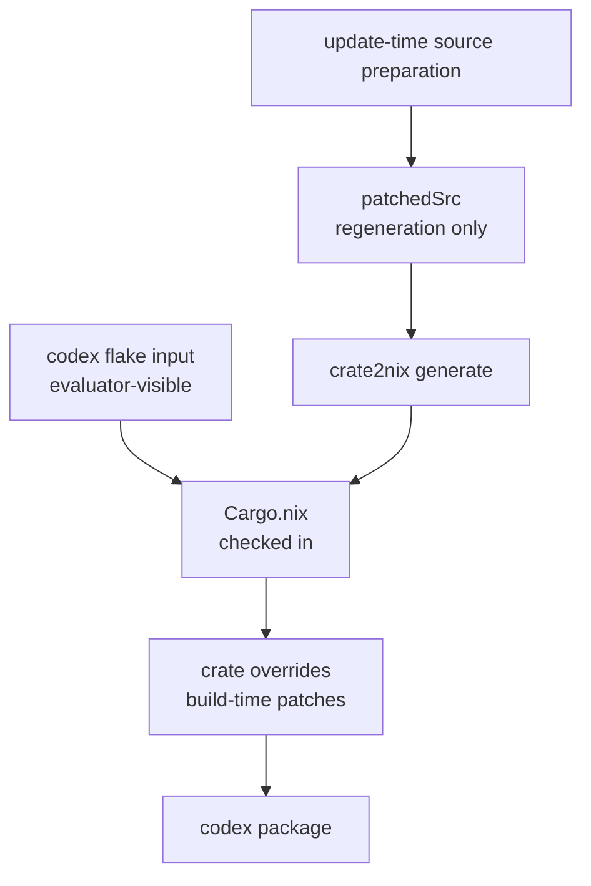

# Codex crate2nix packaging notes

This package builds Codex with
[crate2nix](https://github.com/nix-community/crate2nix) from the upstream Rust
workspace.

## File ownership

### Generated

- `Cargo.nix`
- `crate-hashes.json`

### Hand-maintained

- `default.nix`
  - update-time source preparation for the checked-in workspace layout
  - build-time patches for the individual crates that need them
  - crate overrides, install checks, and smoke checks
  - final package assembly
- `normalize_cargo_nix.py`
  - pure package-specific callback that the central crate2nix normalizer loads

## Current strategy

- import the checked-in `Cargo.nix` with the evaluator-visible `codex` flake
  input as `rootSrc`
- let `Cargo.nix` keep its per-crate source filters, so unrelated workspace
  changes do not invalidate every local crate
- apply production source surgery only in the affected crate overrides
- keep the complete `patchedSrc` workspace only as the crate2nix regeneration
  artifact
- keep compatibility shims centralized in `crateOverrides`
- fail evaluation early if the checked-in `Cargo.nix` version no longer matches
  the upstream `codex-cli` crate version

The split is deliberate. Evaluation never needs to realize and inspect
`patchedSrc`. The updater still regenerates `Cargo.nix` from exactly the
workspace shape that it expects.



## Regenerating `Cargo.nix`

```bash
nix run .#nixcfg -- ci pipeline crate2nix --write --package codex
```

The `.#` form evaluates the Git tracked source set. Stage new or renamed
artifacts before this command, so Nix can see them.

For the lower-level manual flow:

```bash
nix build --impure --no-link --print-out-paths .#codex-crate2nix-src
crate2nix generate \
  -f "$PATCHED_SRC/Cargo.toml" \
  -o packages/codex/Cargo.nix \
  -h packages/codex/crate-hashes.json \
  --default-features
nix run .#nixcfg -- ci pipeline crate2nix normalize codex
```

## Recommended validation

```bash
nix run .#nixcfg -- ci pipeline crate2nix --package codex
nix eval --option allow-import-from-derivation false --raw .#codex.drvPath
nix build .#codex --no-link
CODEX=$(nix path-info .#codex)/bin/codex
"$CODEX" --version
"$CODEX" --help >/dev/null
```

## Related

- [Packaging](../../docs/packaging.md)
- [Source modifications](../../docs/source-modifications.md)
- [Development](../../docs/development.md)
- [Update pipeline](../../docs/update/README.md)
- [Update safety](../../docs/update/safety.md)
