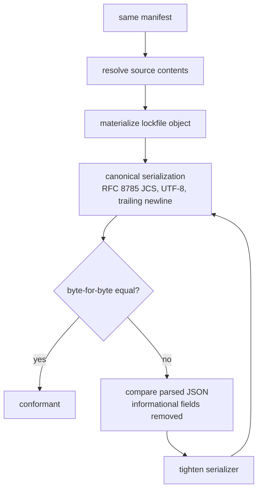

# Deterministic codegen lockfile specification

This document defines the intended cross-language generation semantics for
`version: 1` lockfiles that conform to `codegen-lock.schema.json`.

The goal is a lockfile that independent implementations in Python, Go, or other
languages can materialize from the same manifest and the same source contents.
The design does not depend on a hosted schema registry.

## Scope

This specification covers:

- schema validation inputs
- canonical lockfile serialization
- path normalization
- hashing rules
- the distinction between semantic fields and informational fields

The specification does not yet standardize every manifest evaluation rule.
Feature growth in manifest loading, source discovery, and generator execution
can continue separately from the lockfile wire format.

## Schema identity and validation

Implementations should validate against the checked-in local schema files:

- `schemas/codegen/codegen.schema.json`
- `schemas/codegen/codegen-lock.schema.json`

The schema `$id` values are stable `urn:uuid:` identifiers. They identify the
schema documents, but they are not fetch URLs and they do not require network
resolution.

## Recommended file names and placement

The recommended v1 layout is:

- manifest: `codegen.yaml` or `codegen.json`
- lockfile: `codegen.lock.json`
- both files in the same directory

Implementations may support other layouts. The normalization rules below still
apply.

## Canonical output format

Lockfiles are machine-written **JSON** documents.

For byte-for-byte stable output across languages, writers should:

1. serialize the lockfile as UTF-8 JSON in the
   [RFC 8785](https://www.rfc-editor.org/rfc/rfc8785) JCS (JSON
   Canonicalization Scheme) form
1. append a single trailing `\n`
1. omit any UTF-8 BOM

This result gives a shared cross-language normalization target. The target does
not depend on the pretty-printer conventions of one language runtime.

## Path normalization

### General rules

All path-like fields in the lockfile use POSIX conventions:

- separator is `/`
- no leading `./`
- redundant separators are collapsed
- `.` path segments are removed
- paths must not escape their logical base through an unresolved `..`

### Field-specific bases

- `manifest_path`
  - normalized relative path from the lockfile directory to the manifest file
- `LockedDirectorySource.path`
  - normalized relative path from the manifest directory to the source root on
    disk
- `LockedGitHubRawSource.path`
  - normalized repository-relative POSIX path inside the upstream repository

## Semantic fields and informational fields

### Semantic fields

These fields participate in the locked meaning of the file. Use them for
equality checks and change detection:

- top level: `version`, `manifest_path`, `sources`
- directory sources: `kind`, `path`, `content_sha256`
- URL sources: `kind`, `uri`, `sha256`
- GitHub raw sources: `kind`, `owner`, `repo`, `ref`, `path`, `uri`, `sha256`

### Informational fields

These fields are metadata for debugging, provenance, or observability. They
should **not** affect semantic equality:

- top level: `generated_at`
- directory sources: `generated_at`
- URL sources: `fetched_at`, `etag`, `last_modified`
- GitHub raw sources: `fetched_at`, `tag`, `package`, `package_version`

Writers should omit informational fields by default in reproducible mode.
Consumers should ignore informational-field differences for any change decision
about locked content.

## Hashing rules

### Scalar fetched content

For `LockedUrlSource.sha256` and `LockedGitHubRawSource.sha256`:

- hash the exact fetched response body bytes
- encode the digest as lowercase hexadecimal SHA-256
- do not hash decoded text, transformed JSON, or normalized line endings

### Directory content hash

`LockedDirectorySource.content_sha256` is optional. When present, an
implementation should compute the hash deterministically from the materialized
file set.

Algorithm:

1. materialize the matched regular files of the directory source
1. compute the normalized relative POSIX path of each file from the source root
1. compute the lowercase hex SHA-256 of each file over its raw bytes
1. sort the files lexicographically by normalized relative path
1. build UTF-8 records of the form:
   - `<path>\0<file-sha256>\n`
1. concatenate those records in sorted order
1. SHA-256 the concatenated bytes and encode as lowercase hex

Notes:

- symlinks, device files, sockets, and other non-regular files are out of scope
  for v1. They should cause the hash step to fail rather than silently diverge.
  This includes a symlink used as the source root and symlinked directories
  encountered during traversal, even when the symlink resolves to a directory.
- empty materialized file sets hash as the SHA-256 of the empty byte string

## Directory source matching

For deterministic hashing, directory source matching should use POSIX-style
glob semantics relative to the source root:

- matching is case-sensitive
- `*` does not cross `/`
- `**` may cross `/`
- matched paths are normalized before sorting and hashing

## URL source rules

For locked URL sources:

- `uri` is the canonical configured source URI, not a transient redirect target
- `sha256` is over the fetched response body bytes for that source
- `etag` and `last_modified` are optional response metadata only

## GitHub raw source rules

For locked GitHub raw sources:

- `ref` should be the immutable commit SHA actually fetched
- `path` must be repository-relative after normalization. Absolute paths,
  empty paths, and `..` traversal that escapes the repository root are invalid.
- `uri` should be the canonical raw-content URL derived from `owner`, `repo`,
  the resolved `ref`, and `path`. Percent-encode each `path` segment for URL
  transport so reserved characters such as `?` and `#` remain path data rather
  than becoming a query or fragment; keep `path` itself unescaped.
- `tag` may preserve the original human-facing tag name when a tag resolves to
  the stored commit SHA
- `package` and `package_version` are provenance fields only

## Reproducible mode

Reproducible mode should be the default behavior for lockfile writers.

In reproducible mode, implementations should:

- omit `generated_at`
- omit `fetched_at`
- omit `etag`
- omit `last_modified`
- omit GitHub provenance fields (`tag`, `package`, `package_version`)
- omit any other non-semantic metadata unless explicitly requested
- emit canonical JSON as described above

A non-reproducible "annotated" mode can still exist for debugging or audit
workflows. That mode should be opt-in.

## Conformance testing

The practical compatibility test for multiple implementations is:

1. load the same manifest
1. resolve the same source contents
1. materialize the lockfile object
1. serialize with the canonical rules above
1. compare the resulting bytes

If byte-for-byte equality is too strict during development, compare the parsed
JSON with the informational fields removed. Then tighten to canonical bytes
when both implementations support the same serializer.

## Related

- [Development](../../docs/development.md)
- [Architecture](../../docs/architecture.md)
- [Repository README](../../README.md)
