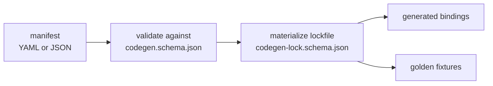

# Codegen manifest schemas

These [JSON Schemas](https://json-schema.org/) define a language-agnostic
configuration format for cross-language code generation.

## Files

- `codegen.schema.json` — human-authored manifest format
- `codegen-lock.schema.json` — machine-written lockfile format
- `LOCKFILE_SPEC.md` — deterministic cross-language lockfile generation rules

## Intended workflow

1. author a manifest in YAML or JSON
1. validate the manifest against `codegen.schema.json`
1. materialize a lockfile that conforms to `codegen-lock.schema.json`
1. generate language bindings for the schemas themselves

## Lockfile CLI

- Python reproducible default output:
  - `uv run python nixcfg.py schema lock path/to/codegen.yaml`
- Python with informational timestamps and provenance metadata:
  - `uv run python nixcfg.py schema lock path/to/codegen.yaml --include-metadata`

## Generated bindings

Current generated bindings in this repo:

- Python: `lib/schema_codegen/models/_generated.py`

## Golden fixtures

Golden fixtures live under:

- `schemas/codegen/testdata/`

## Schema identity

The schema `$id` values currently use stable `urn:uuid:` identifiers instead of
hosted URLs. They do not imply a public domain or a publication contract.

## Language neutrality

The schemas are intentionally language-neutral. Thus other implementations can
materialize compatible lockfiles.

## Related

- [Development](../../docs/development.md)
- [Architecture](../../docs/architecture.md)
- [Repository README](../../README.md)
